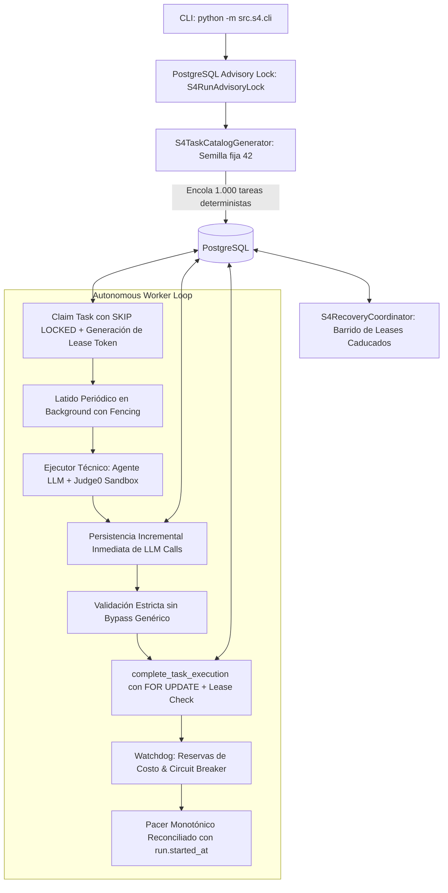

# S4 — Guía Operativa del Autonomous Load Runner

Este documento detalla la arquitectura, operación, monitoreo, recuperación y ejecución por línea de comandos (CLI) del motor de carga autónomo para el reto **S4 (Semana de Carga: 1.000 tareas / 12 horas)** en el Evaluador-Técnico.

---

## 1. Arquitectura del Runner Autónomo (Fase 2.5)

El sistema de carga opera completamente desacoplado mediante PostgreSQL, exclusión mutua de sesión (`pg_try_advisory_lock`), validación estricta de leases (*fencing* de worker), persistencia incremental de llamadas LLM y reloj monotónico reconciliable con la base de datos:



### Componentes Principales

1. **`S4RunAdvisoryLock` (`src/s4/lock.py`):**
   - Adquiere un bloqueo consultivo determinista de PostgreSQL a nivel de conexión por corrida (`SELECT pg_try_advisory_lock(...)`).
   - Impide de forma absoluta que dos procesos independientes ejecuten o interfieran con el mismo `run_id`.
   - Se libera automáticamente al cerrarse la conexión o al terminar el proceso.

2. **Fencing de Leases (`src/s4/service.py`):**
   - Cada tarea claimed recibe un `lease_token` criptográfico único y un `lease_generation` incremental.
   - Tanto `update_task_heartbeat` como `complete_task_execution` validan estrictamente bajo `FOR UPDATE` que el worker solicitante sea el poseedor del lease activo. Si la tarea fue recuperada y reasignada a otro worker, cualquier intento de finalización o latido del worker antiguo es rechazado con `S4WorkerLeaseExpiredError`.

3. **Persistencia Incremental de Llamadas LLM (`src/s4/agent_executor.py` y `src/s4/worker.py`):**
   - Las llamadas al modelo LLM no se acumulan en memoria; se persisten en PostgreSQL inmediatamente tras recibir la respuesta HTTP, antes de despachar la siguiente acción o evaluar código en Judge0.
   - En caso de timeout de red o fallo no controlado, las llamadas intermedias ya realizadas y cobradas quedan registradas con su identificador de pasarela (`cf-ray`, `x-request-id`) y estado de medición (`timeout_uncertain` o `failed_http`).

4. **`S4Pacer` Durable (`src/s4/pacer.py`):**
   - Combina la precisión libre de saltos de `time.monotonic()` con la persistencia de `run.started_at` en PostgreSQL.
   - Al reiniciar un runner tras una interrupción, reconcilia el tiempo transcurrido real con la base de datos, evitando falsas pausas de adelanto o ráfagas descontroladas.
   - Cadencia nominal: **43.20 segundos por tarea (83.33 tareas/hora)** para 1.000 tareas en 12 horas.

5. **`S4Watchdog` con Reserva de Costo (`src/s4/watchdog.py`):**
   - **Reserva de Presupuesto:** Antes de despachar una tarea, reserva un costo estimado conservador ($0.05 USD) contra el saldo disponible, impidiendo que múltiples workers concurrentes excedan el límite de presupuesto.
   - **Disyuntores:** Se dispara ante 5 fallos consecutivos o tasa de fallo > 50% en ventana de 20 tareas.
   - **Persistencia Durable:** Al dispararse, actualiza inmediatamente la corrida a `status = 'paused'` en PostgreSQL y persiste el timestamp y motivo del disparo en `s4_load_runs.meta`.

6. **Guardia de Duración Mínima (`src/s4/service.py`):**
   - `finish_load_run` exige que para marcar una corrida como `COMPLETED`, además de `completed_tasks >= target_tasks`, hayan transcurrido al menos `min_duration_seconds` (por defecto 43.200 segundos / 12 horas) y que no queden tareas en vuelo.

---

## 2. Parámetros de Operación

| Parámetro | Valor por Defecto | Descripción |
| :--- | :--- | :--- |
| `target_tasks` | `1000` | Unidades de trabajo completas a resolver |
| `total_duration_seconds` | `43200.0` (12h) | Tiempo mínimo de ejecución continua |
| `target_cadence` | `43.20 s/tarea` | Ritmo nominal programado |
| `budget_limit_usd` | `$40.00 USD` (configurable) | Límite máximo de gasto antes del disyuntor |
| `max_consecutive_failures`| `5` | Fallos consecutivos antes de pausar la corrida |
| `heartbeat_interval_seconds` | `10.0 s` | Frecuencia de emisión de latidos del worker |
| `orphan_timeout_seconds` | `120.0 s` | Tiempo sin latidos para declarar tarea huérfana |
| `max_recovery_attempts` | `3` | Intentos máximos de recuperación por tarea |

---

## 3. Uso de la Interfaz CLI (`python -m src.s4.cli`)

### 3.1. Diagnóstico Preflight del Sistema (Cero Costo)
Verifica conectividad a PostgreSQL, Redis, Judge0 local, espacio en disco y variables obligatorias:
```bash
python3 -m src.s4.cli --preflight
```

### 3.2. Ejecución en Modo Offline / Mock (Simulación Completa $0.00)
Ejecuta la corrida de forma 100% aislada con el ejecutor sintético determinista:
```bash
python3 -m src.s4.cli --tasks 10 --mock --offline
```

### 3.3. Ejecución Controlada en Modo Real (Smoke Test o Corrida Oficial)
> [!IMPORTANT]
> En modo real, `--budget-usd` es obligatorio y debe ser autorizado expresamente. Nunca introduzca claves de API por argumentos CLI; éstas se leen exclusivamente desde variables de entorno.

```bash
# Prevención de suspensión y cierre de tapa en host Linux:
systemd-inhibit --what=idle:sleep:handle-lid-switch \
  python3 -m src.s4.cli --tasks 1000 --budget-usd 40.0 --interval 43.20
```

### 3.4. Reanudar una Corrida Existente
Reanuda una corrida previa reconciliando el tiempo acumulado contra `run.started_at`:
```bash
python3 -m src.s4.cli --run-id "da234a78-3bdd-499d-9531-7dd8127b0ecd" --resume --budget-usd 40.0
```

### 3.5. Exportar Evidencias JSON y CSV
Exporta la bitácora reproducible directamente desde PostgreSQL con identificadores de pasarela y trazabilidad completa:
```bash
python3 -m src.s4.cli --run-id "da234a78-3bdd-499d-9531-7dd8127b0ecd" --export
```

---

## 4. Manejo de Señales de Sistema Operativo

Al recibir `SIGINT` (`Ctrl+C`) o `SIGTERM` (enviado por el gestor de procesos):
1. El worker deja de reclamar nuevas tareas encoladas.
2. Permite que la tarea en ejecución activa termine su transacción limpia.
3. El watchdog libera las reservas de costo pendientes.
4. Se libera el `S4RunAdvisoryLock` de PostgreSQL.
5. Se cierran los pools de conexiones asíncronas.
6. El proceso sale con código limpio (`130` o `0`).
