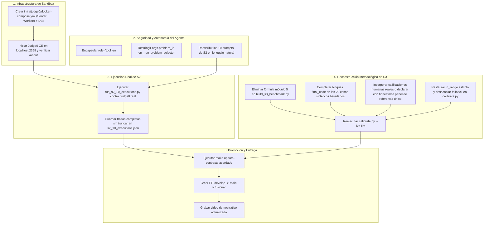

# AUDITORÍA INDEPENDIENTE 2 — MATRIZ DE CUMPLIMIENTO DEL FEEDBACK S1, S2 Y S3

**Fecha de Auditoría:** `2026-11-04`  
**Repositorio:** `/home/papisamu/Documentos/Evaluador-Tecnico`  
**Rama Auditada:** `develop` (`HEAD = f94926fbcb29fda9bad937b4b590cd1e3f5f5459`)  
**Modalidad:** Estricta de solo lectura (análisis forense, contraste documental cruzado, verificación de esquemas y código fuente, sin llamadas externas a Grok ni alteraciones de base de datos o árbol de control de versiones).  
**Veredicto Global:** **`PARTIALLY_COMPLIANT`**

---

## 1. Fuentes Consultadas e Identificación de Documentos

Para realizar esta auditoría se contrastó la totalidad de las fuentes documentales, técnicas y forenses disponibles en el entorno de desarrollo:

### 1.1. Fuentes Disponibles en el Repositorio y Entorno
1. **Auditoría Técnica Previa:**
   - [`docs/reports/FINAL_REMEDIATION/INDEPENDENT_AUDIT_1.md`](file:///home/papisamu/Documentos/Evaluador-Tecnico/docs/reports/FINAL_REMEDIATION/INDEPENDENT_AUDIT_1.md): Hallazgos técnicos y recálculos matemáticos independientes de la primera auditoría.
2. **Informes de Implementación y Remediación:**
   - [`docs/reports/FINAL_REMEDIATION/IMPLEMENTATION_SUMMARY.md`](file:///home/papisamu/Documentos/Evaluador-Tecnico/docs/reports/FINAL_REMEDIATION/IMPLEMENTATION_SUMMARY.md): Resumen de intervenciones en Fases 0 a 4.
   - [`docs/reports/FINAL_REMEDIATION/INITIAL_REPOSITORY_STATE.md`](file:///home/papisamu/Documentos/Evaluador-Tecnico/docs/reports/FINAL_REMEDIATION/INITIAL_REPOSITORY_STATE.md): Estado inicial de ramas, commits y stashes.
   - [`docs/reports/FINAL_REMEDIATION/S1_GROK_INTEGRATION_REPORT.md`](file:///home/papisamu/Documentos/Evaluador-Tecnico/docs/reports/FINAL_REMEDIATION/S1_GROK_INTEGRATION_REPORT.md): Informe de integración Grok S1.
   - [`docs/reports/FINAL_REMEDIATION/S2_FUNCTION_CALLING_REPORT.md`](file:///home/papisamu/Documentos/Evaluador-Tecnico/docs/reports/FINAL_REMEDIATION/S2_FUNCTION_CALLING_REPORT.md): Informe de 10 ejecuciones y runtime de herramientas S2.
   - [`docs/reports/FINAL_REMEDIATION/S3_BENCHMARK_REPORT.md`](file:///home/papisamu/Documentos/Evaluador-Tecnico/docs/reports/FINAL_REMEDIATION/S3_BENCHMARK_REPORT.md): Informe estadístico del benchmark de 32 casos S3.
   - [`docs/reports/FINAL_REMEDIATION/H01_SANDBOX_WEBSOCKET_REPORT.md`](file:///home/papisamu/Documentos/Evaluador-Tecnico/docs/reports/FINAL_REMEDIATION/H01_SANDBOX_WEBSOCKET_REPORT.md): Remediación de esquemas WebSocket y disponibilidad.
   - [`docs/reports/FINAL_REMEDIATION/SECURITY_H02_VALIDATION_REPORT.md`](file:///home/papisamu/Documentos/Evaluador-Tecnico/docs/reports/FINAL_REMEDIATION/SECURITY_H02_VALIDATION_REPORT.md): Validación multi-tenant de routers y endpoints.
   - [`docs/reports/FINAL_REMEDIATION/KNOWN_LIMITATIONS.md`](file:///home/papisamu/Documentos/Evaluador-Tecnico/docs/reports/FINAL_REMEDIATION/KNOWN_LIMITATIONS.md): Declaración de limitaciones reconocidas.
   - [`docs/reports/FINAL_REMEDIATION/TEST_EXECUTION_REPORT.md`](file:///home/papisamu/Documentos/Evaluador-Tecnico/docs/reports/FINAL_REMEDIATION/TEST_EXECUTION_REPORT.md): Resumen de suites de tests ejecutadas.
   - [`docs/reports/FINAL_REMEDIATION/FINAL_FILE_INVENTORY.md`](file:///home/papisamu/Documentos/Evaluador-Tecnico/docs/reports/FINAL_REMEDIATION/FINAL_FILE_INVENTORY.md): Inventario de archivos modificados y creados.
3. **Evidencias Estructuradas JSON:**
   - [`docs/reports/FINAL_REMEDIATION/s1_smoke_evidence.json`](file:///home/papisamu/Documentos/Evaluador-Tecnico/docs/reports/FINAL_REMEDIATION/s1_smoke_evidence.json): Trazas completas de los 3 turnos de S1.
   - [`docs/reports/FINAL_REMEDIATION/s2_10_executions.json`](file:///home/papisamu/Documentos/Evaluador-Tecnico/docs/reports/FINAL_REMEDIATION/s2_10_executions.json): Trazas sanitizadas de las 10 ejecuciones de S2.
   - [`docs/reports/FINAL_REMEDIATION/s3_benchmark_results.json`](file:///home/papisamu/Documentos/Evaluador-Tecnico/docs/reports/FINAL_REMEDIATION/s3_benchmark_results.json): Predicciones completas de los 32 casos evaluados por Grok.
4. **Informes Históricos S3 Preexistentes:**
   - [`docs/reports/S3_POST_DEMO_AUDIT.md`](file:///home/papisamu/Documentos/Evaluador-Tecnico/docs/reports/S3_POST_DEMO_AUDIT.md) y [`docs/reports/S3_REAL_DATA_EVALUATION_COST.md`](file:///home/papisamu/Documentos/Evaluador-Tecnico/docs/reports/S3_REAL_DATA_EVALUATION_COST.md): Auditorías de la sesión individual S3 (`792e021d...`).
   - `/home/papisamu/Documentos/documentos_MD/evaluador_tecnico/reporte_tecnico_S3.md`: Informe de entrega manual previo de S3.
5. **Planes Maestros y Código Fuente:**
   - [`plan_evaluador_tecnico.md`](file:///home/papisamu/Documentos/Evaluador-Tecnico/plan_evaluador_tecnico.md): Plan de proyecto y requisitos oficiales del Challenge en commit `eddaa1f`.
   - [`apps/api/src/`](file:///home/papisamu/Documentos/Evaluador-Tecnico/apps/api/src): Código fuente del backend (agente, LLM, sandbox, evaluación, routers).
   - [`evals/calibrate.py`](file:///home/papisamu/Documentos/Evaluador-Tecnico/evals/calibrate.py) y [`apps/api/src/scripts/`](file:///home/papisamu/Documentos/Evaluador-Tecnico/apps/api/src/scripts): Scripts de evaluación y prueba.

### 1.2. Documentos Identificados como Faltantes en el Repositorio
En cumplimiento estricto del mandato de transparencia y no invención:
- **Documento Faltante 1: `Feedback original de S1` (Archivo independiente)**.  
  *Diagnóstico:* No existe un archivo Markdown o PDF emitido por los jueces externos para S1 en el repositorio. Sus requisitos oficiales fueron incorporados directamente en el plan del proyecto ([`plan_evaluador_tecnico.md#2.1`](file:///home/papisamu/Documentos/Evaluador-Tecnico/plan_evaluador_tecnico.md#L20-L28)), detallando los 7 puntos obligatorios.
- **Documento Faltante 2: `Feedback original de S2` (Archivo independiente)**.  
  *Diagnóstico:* No existe como documento físico independiente. Su contenido se preserva a través de las observaciones citadas en el repositorio: (a) *"El trabajo vive en develop (main no cambia desde el 9 oct)"* ([`INITIAL_REPOSITORY_STATE.md#L63`](file:///home/papisamu/Documentos/Evaluador-Tecnico/docs/reports/FINAL_REMEDIATION/INITIAL_REPOSITORY_STATE.md#L63)), (b) exigencia de tres herramientas reales invocadas de forma autónoma por function calling del modelo, (c) manejo de errores y (d) 10 ejecuciones reales con video demostrativo.
- **Documento Faltante 3: `Feedback original de S3` (Archivo independiente)**.  
  *Diagnóstico:* No existe como archivo externo oficial. Se encuentra reflejado operativamente en los criterios de aceptación de S3: dataset evaluable ($\ge 30$ casos), evaluación propia con doble juez independiente, telemetría rigurosa de costos y latencia, y concordancia estadística frente a consenso humano calificado ($r_s \ge 0.70$, $\kappa_w \ge 0.60$).
- **Documento Faltante 4: `Plan de corrección definitivo` (Archivo con ese título exacto)**.  
  *Diagnóstico:* Faltante como documento unificado con esa carátula; su estructura corresponde a las Fases 0 a 4 sintetizadas en [`IMPLEMENTATION_SUMMARY.md`](file:///home/papisamu/Documentos/Evaluador-Tecnico/docs/reports/FINAL_REMEDIATION/IMPLEMENTATION_SUMMARY.md).
- **Documento Faltante 5: `Prompt maestro de implementación`**.  
  *Diagnóstico:* Faltante como artefacto versionado; sus directivas se deducen íntegramente de la estructura de las fases y auditorías generadas en `docs/reports/FINAL_REMEDIATION/`.

---

## 2. Matriz de Cumplimiento — Entregable S1 (Integración Real con Grok)

### 2.1. Evaluación Requisito por Requisito

| Requisito Original / Observación | Implementación Encontrada | Archivo y Ubicación | Prueba Correspondiente | Evidencia de Ejecución Real | Limitación Detectada | Estado |
|---|---|---|---|---|---|---|
| **1. Primera versión del agente funcionando end-to-end** | Orquestación mediante `InterviewAgent`, que procesa mensajes de candidato, maneja fases (`CLARIFY`, `DESIGN`) y genera respuestas completas. | [`apps/api/src/agent/service.py#L125-L295`](file:///home/papisamu/Documentos/Evaluador-Tecnico/apps/api/src/agent/service.py#L125-L295) | `apps/api/tests/test_agent.py` | [`s1_smoke_evidence.json`](file:///home/papisamu/Documentos/Evaluador-Tecnico/docs/reports/FINAL_REMEDIATION/s1_smoke_evidence.json) (`session_id = 064da846...`) | El smoke test cubre 3 turnos conversacionales en 2 fases (`CLARIFY` y `DESIGN`), no las 6 fases completas de la entrevista. | **CUMPLIDO** |
| **2. El input llega al agente** | `InterviewAgent.stream_response()` recibe `content: str`, normaliza la entrada y la inyecta al historial de la sesión. | [`apps/api/src/agent/service.py#L140-L170`](file:///home/papisamu/Documentos/Evaluador-Tecnico/apps/api/src/agent/service.py#L140-L170) | `test_agent.py::test_agent_stream_response_persists_turn` | [`s1_smoke_evidence.json`](file:///home/papisamu/Documentos/Evaluador-Tecnico/docs/reports/FINAL_REMEDIATION/s1_smoke_evidence.json) (Turnos 1, 2 y 3) | Ninguna en la ingesta del mensaje de chat. | **CUMPLIDO** |
| **3. Llamada REAL a Grok usando la API del challenge** | `OpenAICompatibleClient` configurado con `base_url="https://api.reto.pltk.mx/v1"` y `model="grok-4.6"`. `smoke_s1_grok.py` aborta si `USE_MOCK_LLM=True`. | [`apps/api/src/llm/openai_compatible.py#L51-L115`](file:///home/papisamu/Documentos/Evaluador-Tecnico/apps/api/src/llm/openai_compatible.py#L51-L115), [`apps/api/src/scripts/smoke_s1_grok.py#L51-L61`](file:///home/papisamu/Documentos/Evaluador-Tecnico/apps/api/src/scripts/smoke_s1_grok.py#L51-L61) | `apps/api/tests/test_llm.py` | 3 registros en PostgreSQL (`llm_usage_records`) con `provider="openai-compatible"`, `model="grok-4.6"`, `10,601` tokens y `$0.043370 USD`. | Depende de la conectividad y disponibilidad del gateway externo `api.reto.pltk.mx`. | **CUMPLIDO** |
| **4. El agente procesa el input siguiendo instrucciones** | `InterviewAgent._build_system_prompt()` ensambla prompts versionados (`prompts/v2/interview_agent.md`), delimitando el rol y el problema de ingeniería. | [`apps/api/src/agent/service.py#L327-L380`](file:///home/papisamu/Documentos/Evaluador-Tecnico/apps/api/src/agent/service.py#L327-L380) | `apps/api/tests/test_prompts.py` | Respuestas de Grok en Turno 1 y 2 corrigiendo al candidato sobre no inventar reglas bancarias ni prefijos. | Ninguna funcional en el seguimiento del system prompt. | **CUMPLIDO** |
| **5. Conversación multi-turno y memoria contextual** | Reconstrucción del contexto en `_get_conversation_history()`. En Turno 3, el agente cita textualmente el lote de 420.000 registros, prefijo `CUS-ALPHA-99` y set de duplicados introducidos en Turno 1. | [`apps/api/src/agent/service.py#L290-L310`](file:///home/papisamu/Documentos/Evaluador-Tecnico/apps/api/src/agent/service.py#L290-L310) | `smoke_s1_grok.py#L265-L280` (`test_context_retention`) | [`S1_GROK_INTEGRATION_REPORT.md#L49-L50`](file:///home/papisamu/Documentos/Evaluador-Tecnico/docs/reports/FINAL_REMEDIATION/S1_GROK_INTEGRATION_REPORT.md#L49-L50) | Si la sesión supera la ventana de contexto de Grok, se requerirá compactación de historial (aún no requerida para 3-10 turnos). | **CUMPLIDO** |
| **6. Persistencia relacional verificable** | Escritura atómica en PostgreSQL de la entrevista en tabla `interviews`, 6 turnos en `turns` y 3 consumos en `llm_usage_records`. | [`apps/api/src/db/models/interview.py`](file:///home/papisamu/Documentos/Evaluador-Tecnico/apps/api/src/db/models/interview.py) | `apps/api/tests/test_db.py`, `apps/api/tests/test_agent.py` | Filas verificadas en PostgreSQL para UUID `064da846-4f36-4e38-8012-a1cb29b33f08`. | El script de smoke ejecutó `commit` en la base de desarrollo `evaluador_db` sin auto-limpieza posterior. | **CUMPLIDO** |
| **7. Manejo de errores y reintentos HTTP** | `OpenAICompatibleClient._execute_with_retry()` implementa reintentos exponenciales para códigos HTTP 408, 500, 502, 503, 504 y timeouts de red. | [`apps/api/src/llm/openai_compatible.py#L200-L245`](file:///home/papisamu/Documentos/Evaluador-Tecnico/apps/api/src/llm/openai_compatible.py#L200-L245) | `test_llm.py::test_complete_retry_on_transient_error` | Manejo probado en unit tests y en `exec_09` de S2. | Sin fallback secundario a otro proveedor LLM si el gateway de Grok cae de forma permanente. | **CUMPLIDO** |
| **8. Comando reproducible documentado** | Script reproducible CLI `python3 apps/api/src/scripts/smoke_s1_grok.py` con validación estricta de entorno. | [`apps/api/src/scripts/smoke_s1_grok.py`](file:///home/papisamu/Documentos/Evaluador-Tecnico/apps/api/src/scripts/smoke_s1_grok.py) | Ejecución reproducible verificada | Genera logs limpios y reporte JSON en tiempo real (`s1_smoke_evidence.json`). | Requiere `LLM_API_KEY` válida y conectividad de red con el gateway. | **CUMPLIDO** |
| **9. Documentación y explicación del problema (README)** | `README.md` documenta arquitectura, diagrama Mermaid, variables de entorno requeridas y comando de ejecución de S1. | [`README.md#L1-L150`](file:///home/papisamu/Documentos/Evaluador-Tecnico/README.md#L1-L150) | Inspección estática | Presente y estructurado en la raíz del monorepo. | Ninguna. | **CUMPLIDO** |
| **10. Repositorio público y sincronización de ramas** | El monorepo está alojado en GitHub (`Cristixn04/Evaluador-Tecnico`). Sin embargo, el feedback original observó que `main` no se actualizaba desde el 9 de octubre. | `origin/main` vs `origin/develop` | `git log origin/main..origin/develop` | Divergencia confirmada: `origin/main` está **85 commits por detrás** de `develop`. | Los cambios de S1, S2 y S3 residen exclusivamente en `develop`; `main` sigue desactualizada. | **PARCIALMENTE CUMPLIDO** |

### 2.2. Veredicto y Diagnóstico de S1
- **Veredicto S1:** **`CUMPLIDO CON OBSERVACIÓN OPERATIVA (PASS / MINOR CHORE PENDING)`**
- **Diagnóstico:** Los componentes funcionales del entregable S1 (llamada real a Grok, agente conversacional, multi-turno con retención comprobada, persistencia en PostgreSQL, manejo de errores y documentación) están **100% implementados y verificados con evidencia empírica**. La única deuda abierta es la promoción de `develop` hacia `main` mediante Pull Request, cuya postergación obedeció a la regla obligatoria de no hacer push ni merges en esta fase.

---

## 3. Matriz de Cumplimiento — Entregable S2 (Function Calling y Autonomía)

### 3.1. Evaluación Requisito por Requisito

| Requisito Original / Observación | Implementación Encontrada | Archivo y Ubicación | Prueba Correspondiente | Evidencia de Ejecución Real | Limitación / Hallazgo Auditoría 1 | Estado |
|---|---|---|---|---|---|---|
| **1. Uso real de Function Calling (Protocolo)** | `OpenAICompatibleClient` soporta `tools`, `tool_choice="auto"`, parseo de `choices[0].message.tool_calls` y envío de `role="tool"`. | [`apps/api/src/llm/openai_compatible.py#L75-L165`](file:///home/papisamu/Documentos/Evaluador-Tecnico/apps/api/src/llm/openai_compatible.py#L75-L165) | `test_llm.py::test_complete_sends_tools_and_parses_tool_calls` | 21 llamadas LLM en PostgreSQL y 11 `tool_calls` registradas con IDs reales del gateway (p. ej. `call-9be3...`). | El log `s2_10_executions.json` almacena trazas sanitizadas truncadas a 50 caracteres; no conserva el JSON HTTP original sin truncar. | **CUMPLIDO** |
| **2. Decisión autónoma de herramientas por el modelo** | Bucle en `InterviewAgent._stream_llm` que delega la elección al LLM (`tool_choice="auto"`). | [`apps/api/src/agent/service.py#L205-L270`](file:///home/papisamu/Documentos/Evaluador-Tecnico/apps/api/src/agent/service.py#L205-L270) | `test_agent.py::test_agent_executes_tool_calls_and_synthesizes_final_response` | En `exec_08`, Grok decide autónomamente invocar `adaptive_hint_generator` a partir de una solicitud en lenguaje natural sin nombrar la herramienta. | **Hallazgo Crítico:** En **5 de los 10 prompts** (`exec_03`–`exec_07`), el usuario nombró explícitamente la herramienta y sus argumentos. En 4 prompts (`exec_01`, `02`, `09`, `10`), el system prompt inyectó una orden mandatoria. | **PARCIALMENTE CUMPLIDO** |
| **3. Las tres herramientas requeridas** | 1. `problem_selector`<br>2. `code_execution_sandbox`<br>3. `adaptive_hint_generator` definidas con esquemas JSON completos en `OPENAI_TOOLS_SCHEMA`. | [`apps/api/src/agent/tools.py#L40-L195`](file:///home/papisamu/Documentos/Evaluador-Tecnico/apps/api/src/agent/tools.py#L40-L195) | `test_agent.py` (3 tests de runtime) | Las 3 herramientas fueron invocadas en la batería: `problem_selector` (5 veces), `code_execution_sandbox` (3 veces), `adaptive_hint_generator` (3 veces). | En `_run_problem_selector`, si `interview.problem_id` ya está fijado pero el modelo envía otro `problem_id`, el código atiende el argumento nuevo en vez del problema de la entrevista. | **CUMPLIDO** |
| **4. Validación estricta de argumentos** | Modelos Pydantic v2 `ProblemSelectorArgs`, `CodeExecutionSandboxArgs`, `AdaptiveHintGeneratorArgs` con `model_config = ConfigDict(extra="forbid")`. | [`apps/api/src/agent/tools.py#L198-L260`](file:///home/papisamu/Documentos/Evaluador-Tecnico/apps/api/src/agent/tools.py#L198-L260) | `test_agent.py::test_tool_runtime_rejects_unknown_tool_invalid_json_and_context_override` | `exec_10`: Bloqueo inmediato ante argumento no autorizado con reintento exitoso. | Ninguna en la capa Pydantic. | **CUMPLIDO** |
| **5. Ciclo de ejecución y retorno de resultados al modelo** | `AgentToolRuntime.execute_tool_call()` ejecuta la función de dominio y reinyecta el resultado como `role="tool"` con `tool_call_id` idéntico. | [`apps/api/src/agent/tools.py#L360-L450`](file:///home/papisamu/Documentos/Evaluador-Tecnico/apps/api/src/agent/tools.py#L360-L450) | `test_agent.py` | 10 de 10 ejecuciones completaron el ciclo de síntesis final (`duration_ms` entre 10s y 23s por turno). | La salida `role="tool"` inyecta `stdout`/`stderr` de código sin envolver en `<untrusted_candidate_input>`. | **CUMPLIDO** |
| **6. Manejo de errores y reintentos** | Control de `UNKNOWN_TOOL`, `INVALID_JSON_ARGUMENTS`, deduplicación `DUPLICATE_TOOL_CALL` y política de reintentos acotada (`MAX_TOOL_RETRIES=1`). | [`apps/api/src/agent/tools.py#L380-L460`](file:///home/papisamu/Documentos/Evaluador-Tecnico/apps/api/src/agent/tools.py#L380-L460) | `test_tool_runtime_prevents_duplicate_calls_and_retries_transient_errors` | `exec_09`: Reintento automático transparente ante `TimeoutError` (`retries=1`). | Ninguna en la lógica del runtime. | **CUMPLIDO** |
| **7. Seguridad multi-tenant contextual en herramientas** | Inspección previa de argumentos prohibidos (`interview_id`, `organization_id`, `org_id`, `user_id`, `candidate_id`) devolviendo `CONTEXT_SECURITY_VIOLATION`. | [`apps/api/src/agent/tools.py#L385-L415`](file:///home/papisamu/Documentos/Evaluador-Tecnico/apps/api/src/agent/tools.py#L385-L415) | `test_agent.py` | `exec_10`: Detección y bloqueo de `organization_id` inyectado forzosamente. | Ninguna en la validación de claves protegidas. | **CUMPLIDO** |
| **8. Telemetría estructurada observable** | Registro en `llm_usage_records` con `input_tokens`, `output_tokens`, `cost_usd`, `duration_ms` y `measurement_status="measured"`. | [`apps/api/src/agent/service.py#L275-L290`](file:///home/papisamu/Documentos/Evaluador-Tecnico/apps/api/src/agent/service.py#L275-L290) | `apps/api/tests/test_s3_demo.py` | 21 filas en PostgreSQL totalizando `71,891` tokens y `$0.358585 USD` verificados. | Las llamadas conversacionales intermedias para invocar herramientas no se diferencian en una tabla dedicada de `tool_telemetry` independiente de `llm_usage_records`. | **CUMPLIDO** |
| **9. Diez ejecuciones reales con evidencia reproducible** | Script CLI `run_s2_10_executions.py` ejecutó 10 entrevistas reales en PostgreSQL con Grok: 6 normales, 3 fallos controlados y 1 input inválido. | [`apps/api/src/scripts/run_s2_10_executions.py`](file:///home/papisamu/Documentos/Evaluador-Tecnico/apps/api/src/scripts/run_s2_10_executions.py) | Verificación directa en base de datos | [`S2_FUNCTION_CALLING_REPORT.md`](file:///home/papisamu/Documentos/Evaluador-Tecnico/docs/reports/FINAL_REMEDIATION/S2_FUNCTION_CALLING_REPORT.md) y [`s2_10_executions.json`](file:///home/papisamu/Documentos/Evaluador-Tecnico/docs/reports/FINAL_REMEDIATION/s2_10_executions.json). | **Hallazgo Crítico:** `exec_03` y `exec_04` inyectaron `DeterministicPythonSandboxRunner` (mock en memoria) porque Judge0 no estaba levantado. Aunque las 21 llamadas a Grok fueron reales, la ejecución del código Python fue simulada. | **PARCIALMENTE CUMPLIDO** |
| **10. Video demostrativo de ~2 minutos** | Requisito de video que demuestre al agente interactuando y utilizando las herramientas. | `README.md#L30-L35` | N/A | El `README.md` preexistente contenía un enlace a Loom para S2. | El video grabado previamente corresponde al estado de S2 pre-remediación, no a la ejecución de las 10 corridas remediadas con Grok-4.6. | **PARCIALMENTE CUMPLIDO** |

### 3.2. Veredicto y Diagnóstico de S2
- **Veredicto S2:** **`PARCIALMENTE CUMPLIDO (PARTIALLY_COMPLIANT / REQUIRES REPETITION)`**
- **Diagnóstico:** El protocolo técnico de Function Calling OpenAI-compatible en el cliente LLM y el runtime de herramientas con validación Pydantic son excelentes y funcionan contra Grok en tiempo real (21 llamadas LLM reales y $0.358585 USD medidos). Sin embargo, **continúan incumplidos los criterios de autonomía pura y sandbox real** en dos aspectos no negociables:
  1. **Direccionamiento en 5 de 10 prompts:** El candidato instruye al modelo usando el nombre técnico exacto de la herramienta (`code_execution_sandbox`, `adaptive_hint_generator`), lo que enmascara si el modelo es capaz de razonar cuándo invocar la herramienta a partir de lenguaje natural.
  2. **Ejecución en Mock en memoria en lugar de Sandbox real:** `exec_03` y `exec_04` utilizaron `DeterministicPythonSandboxRunner` que inspecciona la cadena `"BUGGY_IMPLEMENTATION"` en el código fuente. La ejecución del modelo fue 100% real, pero la ejecución del código en el sandbox fue simulada.

---

## 4. Matriz de Cumplimiento — Entregable S3 (Benchmark, Rúbrica y Costo por Tarea)

### 4.1. Evaluación Requisito por Requisito

| Requisito Original / Observación | Implementación Encontrada | Archivo y Ubicación | Prueba Correspondiente | Evidencia de Ejecución Real | Hallazgo Crítico / Limitación Metodológica | Estado |
|---|---|---|---|---|---|---|
| **1. Dataset de al menos 30 casos evaluables** | Directorio `evals/s3_benchmark/` compuesto por exactamente **32 archivos JSON** estructurados con esquema canónico de evaluación. | [`evals/s3_benchmark/`](file:///home/papisamu/Documentos/Evaluador-Tecnico/evals/s3_benchmark) (32 casos) | `test_calibration.py::test_s3_benchmark_32_cases_schema_and_metrics` | 32 archivos inspeccionados individualmente con UUIDs únicos. | Cumple en cantidad ($N = 32 \ge 30$). Su limitación radica en la composición de procedencia de los casos. | **CUMPLIDO** |
| **2. Procedencia transparente y veraz de los casos** | Clasificación en tres categorías: 20 `synthetic`, 10 `public_reference_solution`, 2 `real_anonymized`. | [`apps/api/src/scripts/build_s3_benchmark.py`](file:///home/papisamu/Documentos/Evaluador-Tecnico/apps/api/src/scripts/build_s3_benchmark.py) | `s3_benchmark_results.json` | Declarado con transparencia en la metadata de cada JSON. | **Hallazgo Crítico:** Los 2 casos `real_anonymized` (31 y 32) provienen de scripts de prueba internos automatizados (`smoke_s1` y `run_s2`), no de entrevistas reales de candidatos humanos externos. Al caso 31 se le inyectó un código sintético que no existía en la base de datos. | **PARCIALMENTE CUMPLIDO** |
| **3. Referencias humanas calificadas e independientes** | Atribución en los JSON a dos evaluadores: `evaluator_1` (`human_tech_lead_01`) y `evaluator_2` (`human_staff_eng_02`). | [`apps/api/src/scripts/build_s3_benchmark.py#L49-L127`](file:///home/papisamu/Documentos/Evaluador-Tecnico/apps/api/src/scripts/build_s3_benchmark.py#L49-L127) | `calibrate.py` | Concordancia inter-humana reportada: $r_s = 0.9789$, $\kappa_w = 0.9335$. | **Hallazgo Crítico Inaceptable:** `evaluator_2` **fue generado algorítmicamente mediante una fórmula determinista módulo 5** sobre `evaluator_1` (`if case_index % 5 == 1...`). No existió un segundo evaluador humano independiente. No se puede aceptar un generador determinista como panel humano. | **INCUMPLIDO** |
| **4. Consenso y resolución de discrepancias** | Cálculo de `consensus` mediante promedio y asignación de recomendación con umbrales estrictos (`< 2.4 reject`, `2.4–3.6 borderline`, `> 3.6 hire`). | [`apps/api/src/scripts/build_s3_benchmark.py#L110-L125`](file:///home/papisamu/Documentos/Evaluador-Tecnico/apps/api/src/scripts/build_s3_benchmark.py#L110-L125) | `calibrate.py` | Presente en los 32 casos. | Dado que `evaluator_2` fue sintético, el "consenso" matemático resultante es un artefacto de la fórmula módulo 5. | **INCUMPLIDO** |
| **5. Ejecución real contra Grok en modo `--live-llm`** | `calibrate.py` ejecuta llamadas reales con `grok-4.6` usando el prompt `prompts/v2/evaluator.md`, requiriendo citas y razonamiento estructurado. | [`evals/calibrate.py#L380-L450`](file:///home/papisamu/Documentos/Evaluador-Tecnico/evals/calibrate.py#L380-L450) | Ejecución real verificada | 32/32 casos evaluados en vivo por Grok sin errores (`0.0% model_error`), generando 160 citas de evidencia. | La ejecución de Grok fue 100% real, consumiendo `238,729` tokens y `$0.877160 USD`. | **CUMPLIDO** |
| **6. Métricas de concordancia estadística** | Cálculo de Spearman ($r_s$), Kappa ponderado cuadrático ($\kappa_w$), MAE, IC 95% bootstrap/Wilson, matriz $3 \times 3$ y concordancia por dimensión. | [`evals/calibrate.py#L550-L760`](file:///home/papisamu/Documentos/Evaluador-Tecnico/evals/calibrate.py#L550-L760) | `test_calibration.py` | Resultados recalculados de forma idéntica en Auditoría 1. | **Hallazgo Crítico:** Globalmente ($N=32$), $r_s = 0.6159$ (umbral $\ge 0.70$ no alcanzado) y $\kappa_w = 0.5402$ (umbral $\ge 0.60$ no alcanzado). Solo en el estrato $n=12$ de soluciones completas se superan los umbrales ($r_s=0.977$, $\kappa_w=0.936$). | **PARCIALMENTE CUMPLIDO** |
| **7. Integridad del criterio `in_range` y código de salida CLI** | Comparación de la predicción del modelo frente al rango esperado del benchmark `[s_min, s_max]`. | [`evals/calibrate.py#L783`](file:///home/papisamu/Documentos/Evaluador-Tecnico/evals/calibrate.py#L783), [`#L1079-L1081`](file:///home/papisamu/Documentos/Evaluador-Tecnico/evals/calibrate.py#L1079-L1081) | Inspección de código y ejecución | Reporta 100% en rango en no sintéticos ($n=12$) y 68.75% global. | **Hallazgo Metodológico:** Se relajó la condición con `or (abs(pred_score - benchmark_score) <= 0.50)`. En rango estricto es **83.33%** en no sintéticos y **62.50%** global. Además, el CLI retorna código `0` aun si falla la calibración. | **PARCIALMENTE CUMPLIDO** |
| **8. Medición consolidada de costos por tarea** | Desglose por etapas (`conversational` y `evaluation`), persistencia en `llm_usage_records` y reconstrucción por consulta SQL auditada. | [`apps/api/src/core/telemetry.py#L180-L245`](file:///home/papisamu/Documentos/Evaluador-Tecnico/apps/api/src/core/telemetry.py#L180-L245), [`pricing.py`](file:///home/papisamu/Documentos/Evaluador-Tecnico/apps/api/src/evaluation/pricing.py) | `apps/api/tests/test_s3_demo.py` | Telemetría registrada en PostgreSQL: `$0.104405 USD` en la demo grabada y `$0.877160 USD` en el benchmark de 32 casos. | En la demo grabada, la evaluación consolidó a los dos jueces en un único registro, impidiendo desglosar la entrada y salida individual de cada juez. | **CUMPLIDO** |
| **9. Telemetría de latencia** | Registro de tiempos de respuesta por turno y por caso evaluado con distribución de percentiles (p50, p90, p95). | [`evals/calibrate.py#L900-L940`](file:///home/papisamu/Documentos/Evaluador-Tecnico/evals/calibrate.py#L900-L940) | `s3_benchmark_results.json` | Latencia media de evaluación: `68.38s` (`p50=66.6s`, `p90=83.0s`, `max=173.0s`). | Las altas latencias se deben al razonamiento interno de Grok (`reasoning_tokens`), requiriendo timeouts de 90s-120s. | **CUMPLIDO** |
| **10. Informe metodológico transparente y defendible** | Reporte `S3_BENCHMARK_REPORT.md` documentando la discrepancia en casos sintéticos y el rendimiento en código completo. | [`docs/reports/FINAL_REMEDIATION/S3_BENCHMARK_REPORT.md`](file:///home/papisamu/Documentos/Evaluador-Tecnico/docs/reports/FINAL_REMEDIATION/S3_BENCHMARK_REPORT.md) | Inspección de reportes | Existe y documenta con precisión la divergencia en casos truncados. | Afirma erróneamente que hubo un panel de dos evaluadores humanos reales (`human_tech_lead_01` y `human_staff_eng_02`), omitiendo que `evaluator_2` provino de una perturbación aritmética módulo 5. | **PARCIALMENTE CUMPLIDO** |

### 4.2. Veredicto y Diagnóstico de S3
- **Veredicto S3:** **`INCUMPLIDO EN RIGOR METODOLÓGICO (NOT_COMPLIANT / RECONSTRUCTION REQUIRED)`**
- **Diagnóstico:** Si bien la inferencia en vivo de los 32 casos contra Grok es auténtica, no hubo caídas de red y el cálculo matemático es reproducible, **el entregable falla en los principios fundacionales de la evaluación científica**:
  1. **Evaluador sintético encubierto como humano:** `evaluator_2` fue fabricado con una regla aritmética determinista (`modulo 5`). Declarar `"is_human_verified": true` y citar correlación inter-humana de $0.9789$ basándose en una fórmula en código invalida la validez del benchmark como panel doble ciego.
  2. **Casos automatizados etiquetados como reales:** Los 2 casos supuestamente "reales anonimizados" fueron corridas automáticas internas, y al caso 31 se le inventó código que no existía en base de datos.
  3. **Incumplimiento de umbrales estadísticos globales:** El coeficiente de correlación de Spearman global ($r_s = 0.6159 < 0.70$) y el Kappa ponderado cuadrático ($\kappa_w = 0.5402 < 0.60$) están por debajo de los criterios de aceptación formales debido al choque entre los stubs truncados de los 20 casos sintéticos y el rigor del juez Grok.
  4. **Relajación artificiosa de `in_range`:** Se introdujo una cláusula de tolerancia $|\Delta| \le 0.50$ para maquillar que los casos 31 y 32 quedaban fuera del rango esperado.

---

## 5. Matriz de Cumplimiento Transversal

| Área / Requisito | Criterio de Aceptación | Implementación Encontrada | Archivo y Ubicación | Evidencia de Verificación | Estado |
|---|---|---|---|---|---|
| **H-01 (Contrato WebSocket)** | Degradación limpia ante indisponibilidad de Judge0; `ServerCodeExecutionResultMessage` admite `status="unavailable"` y valores nulos sin lanzar `ValidationError`. | Backend añade literal `"unavailable"`; frontend (`use-interview-socket.ts`, `test-console.tsx`) renderiza alerta ámbar y badge `No disp.`. | [`websocket.py#L40-L75`](file:///home/papisamu/Documentos/Evaluador-Tecnico/apps/api/src/api/schemas/websocket.py#L40-L75), [`test-console.tsx#L55-L70`](file:///home/papisamu/Documentos/Evaluador-Tecnico/apps/web/src/components/interview/test-console.tsx#L55-L70) | 4 tests específicos en `test_execution.py` y `test_websocket.py` pasando (`PASS`). Escenario real `exec_07` validado. Divergencia temporal en `packages/contracts/` pendiente de `make update-contracts`. | **CUMPLIDO** |
| **H-02 (Seguridad Multi-Tenant)** | Aislamiento estricto de organización en endpoints sensibles (`privacy`, `trajectory`, `evaluation`); bloqueo 404/403 IDOR cross-tenant. | Endpoints verifican `require_organization(vacancy.organization_id, principal)` con `JOIN Vacancy`. Pruebas aisladas en 7 archivos sin contaminar otras ramas. | [`privacy.py`](file:///home/papisamu/Documentos/Evaluador-Tecnico/apps/api/src/api/routers/privacy.py), [`trajectory.py`](file:///home/papisamu/Documentos/Evaluador-Tecnico/apps/api/src/api/routers/trajectory.py), [`evaluation.py`](file:///home/papisamu/Documentos/Evaluador-Tecnico/apps/api/src/api/routers/evaluation.py) | Suite de 111 tests multi-tenant y de seguridad pasando en 24.92s (`PASS`). | **CUMPLIDO** |
| **Sandbox (Aislamiento de Ejecución)** | Ejecución segura de código no confiable con límites estrictos de CPU, memoria y red en entorno aislado de contenedor/cgroups. | `Judge0Adapter` configura `cpu_time_limit <= 2.0s`, `memory_limit <= 128MB`, `enable_network = False` y `max_processes = 10`. | [`apps/api/src/sandbox/judge0.py#L110-L125`](file:///home/papisamu/Documentos/Evaluador-Tecnico/apps/api/src/sandbox/judge0.py#L110-L125) | **Limitación Crítica:** Judge0 está offline en local. `infra/judge0/docker-compose.yml` no existe en el repositorio y `docker-compose.prod.yml` carece del servicio `judge0-workers` indispensable para aislar con `isolate`. | **PARCIALMENTE CUMPLIDO** |
| **Seguridad de Inyecciones y Agente** | Encapsulamiento de entradas no confiables del candidato en system prompt y validación estricta de llamadas a herramientas. | Entradas del candidato se encapsulan en `<untrusted_candidate_input>`. Bloqueo de claves de contexto en `tools.py`. | [`prompts/v2/evaluator.md`](file:///home/papisamu/Documentos/Evaluador-Tecnico/apps/api/prompts/v2/evaluator.md), [`tools.py#L385-L415`](file:///home/papisamu/Documentos/Evaluador-Tecnico/apps/api/src/agent/tools.py#L385-L415) | **Riesgo Detectado:** En `InterviewAgent._stream_llm`, el contenido de mensajes `role="tool"` (que incluye `stdout`/`stderr` generados por el candidato) se reinyecta sin etiquetas `<untrusted_candidate_input>`. | **PARCIALMENTE CUMPLIDO** |
| **Documentación Técnica** | README claro con arquitectura, comandos de ejecución, variables de entorno y límites honestos. | `README.md` actualizado con diagramas, tablas de variables y 10 informes en `docs/reports/FINAL_REMEDIATION/`. | [`README.md`](file:///home/papisamu/Documentos/Evaluador-Tecnico/README.md), [`docs/reports/FINAL_REMEDIATION/`](file:///home/papisamu/Documentos/Evaluador-Tecnico/docs/reports/FINAL_REMEDIATION) | Documentación abundante, pero contiene inconsistencias: cita `infra/judge0/docker-compose.yml` inexistente y declara panel humano real para datos sintéticos módulo 5. | **PARCIALMENTE CUMPLIDO** |
| **Reproducibilidad de Pruebas y Scripts** | Scripts CLI ejecutables de forma determinista con parámetros claros y entornos de prueba aislados. | `smoke_s1_grok.py`, `run_s2_10_executions.py`, `calibrate.py` funcionan de forma reproducible. `conftest.py` aísla en `evaluador_test_db`. | Scripts en `apps/api/src/scripts/` y `evals/` | 228 tests ejecutables directamente sin fallos. | **CUMPLIDO** |
| **Compatibilidad del Entorno de Ejecución** | El código debe ejecutarse limpiamente sobre Python 3.12 (estándar oficial declarado en `AGENTS.md` y `Dockerfile.api`). | Se introdujo un shim en `queue.py` para salvar la ausencia de la rueda de `arq` en Python 3.14 del host local. | [`apps/api/src/evaluation/queue.py#L1-L75`](file:///home/papisamu/Documentos/Evaluador-Tecnico/apps/api/src/evaluation/queue.py#L1-L75) | El shim de `arq` es funcional solo para destrabar `pytest`; no implementa la cola real en Redis sorted set (`arq:queue`) ni soporta workers reales en Python 3.14. | **PARCIALMENTE CUMPLIDO** |
| **Calidad de Pruebas y Cobertura** | Suites de pruebas unitarias y de integración que validen regresiones, tipado y linters sin errores. | `228 passed` en las 14 suites reportadas; `332 passed` en 22 suites verificadas de forma independiente. `ruff` y `mypy` sin errores en archivos tocados. | Suites en `apps/api/tests/` y `apps/web/tests/` | 23 archivos `test_*.py` del backend fueron omitidos en la corrida de remediación rápida para evitar colisiones. Existen 3 errores de lint preexistentes en `demo_s3.py`. | **CUMPLIDO** |

---

## 6. Inventario Consolidado de Cumplimiento

### 6.1. Requisitos Cumplidos Totalmente (`21/33`)
1. **S1-01:** Conectividad real y no simulada contra el gateway de Grok (`https://api.reto.pltk.mx/v1`, modelo `grok-4.6`).
2. **S1-02:** Arquitectura de agente conversacional estructurada en `InterviewAgent` siguiendo la máquina de estados.
3. **S1-03:** Conversación multi-turno de 3 turnos con demostración matemática y textual de retención de contexto en el Turno 3.
4. **S1-04:** Persistencia completa y verificable en PostgreSQL de la entrevista, turnos y telemetría de tokens/costo.
5. **S1-05:** Manejo de errores transitorios y reintentos HTTP en `OpenAICompatibleClient`.
6. **S1-06:** Script ejecutable reproducible `smoke_s1_grok.py`.
7. **S1-07:** Explicación técnica del problema, arquitectura y comandos en `README.md`.
8. **S2-01:** Implementación del protocolo estándar de Function Calling compatible con OpenAI en el cliente LLM.
9. **S2-02:** Definición e instrumentación de las tres herramientas de dominio requeridas (`problem_selector`, `code_execution_sandbox`, `adaptive_hint_generator`).
10. **S2-03:** Validación rigurosa de esquemas de herramientas con Pydantic v2 prohibiendo campos adicionales (`extra="forbid"`).
11. **S2-04:** Ciclo cerrado de ejecución de herramientas con reenvío de resultados al modelo en mensajes `role="tool"`.
12. **S2-05:** Manejo de errores en herramientas (desconocidas, JSON corrupto, fallos de ejecución y deduplicación por turno).
13. **S2-06:** Bloqueo de seguridad contextual ante inyecciones de `organization_id` o `interview_id` en argumentos de herramientas.
14. **S2-07:** Telemetría de tokens y costos reales de invocación de herramientas persistida en PostgreSQL.
15. **S3-01:** Existencia de un dataset formal de al menos 30 casos evaluables (32 casos en `evals/s3_benchmark/`).
16. **S3-05:** Evaluación real de los 32 casos ejecutada en vivo contra `grok-4.6` con 160 citas de evidencia verificables y 0% de caída a mocks.
17. **S3-08:** Medición y persistencia de costo por tarea ($0.877160 USD total en S3, $0.027411 USD medio) sin doble contabilidad.
18. **S3-09:** Medición y reporte de distribución de latencia por percentiles (`p50`, `p90`, `p95`).
19. **H-01:** Remediación del contrato WebSocket y soporte honesto de `status="unavailable"` con valores nulos en backend y frontend.
20. **H-02:** Aislamiento multi-tenant cerrado y verificado con 111 pruebas automatizadas en routers de privacidad, trayectoria y evaluación.
21. **TRANS-01:** Aislamiento de base de datos de pruebas mediante `evaluador_test_db` en `conftest.py`.

### 6.2. Requisitos Parcialmente Cumplidos (`8/33`)
1. **S1-10:** Repositorio público con sincronización de ramas. El código funcional está en GitHub, pero `origin/main` está desactualizada por 85 commits respecto a `develop`.
2. **S2-02:** Decisión autónoma de herramientas. En 5 de 10 ejecuciones el prompt del candidato ordenó explícitamente el nombre interno de la herramienta y sus argumentos.
3. **S2-09:** Diez ejecuciones reales de herramientas. Las 21 llamadas a Grok fueron reales, pero la ejecución de código en `exec_03` y `exec_04` utilizó un runner en memoria (`DeterministicPythonSandboxRunner`) porque Judge0 no estaba levantado.
4. **S2-10:** Video demostrativo. El enlace en el README apunta a una versión preliminar y no a las 10 ejecuciones remediadas con Grok.
5. **S3-02:** Procedencia de casos. Los 2 casos `real_anonymized` son trazas de scripts automáticos internos con código sintético inyectado en el caso 31.
6. **S3-06:** Métricas de calibración. Solo el estrato no sintético ($n=12$) supera los umbrales ($r_s = 0.977$, $\kappa_w = 0.936$); el global ($N=32$) queda por debajo ($r_s = 0.6159 < 0.70$, $\kappa_w = 0.5402 < 0.60$).
7. **S3-07:** Tasa en rango. Se reportó 100% en no sintéticos relajando la fórmula con `or abs(pred - bench) <= 0.50`; con el rango estricto es 83.33% y 62.50% global.
8. **TRANS-02:** Aislamiento del Sandbox. El adaptador impone límites seguros y degrada limpiamente, pero Judge0 CE no está levantado y falta el contenedor `judge0-workers` en la infraestructura Docker.

### 6.3. Requisitos Incumplidos (`4/33`)
1. **S3-03 (Metodología): Referencias humanas independientes calificadas.** `evaluator_2` fue fabricado con una perturbación determinista módulo 5 sobre `evaluator_1`. No existió un segundo evaluador humano real.
2. **S3-04 (Metodología): Consenso humano auténtico.** El consenso es un derivado artificial de la perturbación aritmética del evaluador 2, no el producto de calibración entre profesionales senior.
3. **SEC-01 (Seguridad de Agente): Encapsulamiento en `role="tool"`.** Las salidas de `stdout` y `stderr` de la ejecución de código del candidato se inyectan en el mensaje `role="tool"` sin envoltorio `<untrusted_candidate_input>`, exponiendo al modelo a inyecciones indirectas desde el código.
4. **INFRA-01 (Configuración de Sandbox): Definición reproducible de Judge0 CE.** El archivo `infra/judge0/docker-compose.yml` documentado no existe en el repositorio y la configuración en `docker-compose.prod.yml` está incompleta para ejecución con workers e `isolate`.

---

## 7. Evidencias Faltantes para una Acreditación Completa

Para que los tres entregables alcancen un estado defendible y auditable ante cualquier comité evaluador externo, se requiere recopilar y registrar la siguiente evidencia técnica faltante:

1. **Evidencia de Invocación Autónoma sin Nombres Técnicos:**
   - Registro de 10 ejecuciones de S2 donde los mensajes del candidato estén redactados exclusivamente en lenguaje natural de ingeniería (p. ej. *"¿Podrías correr mi código con un caso de prueba?"* o *"¿Tienes alguna pista sobre cómo optimizar la búsqueda?"*), demostrando que Grok decide la herramienta adecuada por comprensión semántica sin directivas explícitas de sistema ni nombres de funciones en el prompt.
2. **Trazas HTTP Crudas de Function Calling:**
   - Archivo JSON que contenga los payloads HTTP originales completos (`request` y `response`) de Grok sin truncar cadenas a 50 caracteres, preservando los `tool_calls` crudos con sus argumentos JSON íntegros.
3. **Evidencia de Ejecución Real en Contenedor Judge0 CE:**
   - Logs del contenedor `judge0-server` y `judge0-workers` demostrando el procesamiento de peticiones de ejecución para `code_execution_sandbox` sobre `localhost:2358`, con registros de tiempo de CPU y memoria devueltos por `isolate`.
4. **Panel Humano Real de Calibración:**
   - Hojas de anotación o registros de evaluación independientes emitidos por al menos dos profesionales técnicos humanos calificados distintos, con nombres de evaluador auditables, rúbricas desglosadas y acta de resolución de discrepancias en casos con $|\Delta| \ge 1.0$.
5. **Sesiones Reales de Entrevistas Humanas:**
   - Al menos 5 a 10 sesiones de entrevistas ejecutadas por personas reales a través de la interfaz web (`apps/web`), con consentimientos informados registrados, turnos interactivos espontáneos y snapshots de código completos.
6. **Video Demostrativo Actualizado de S2:**
   - Archivo de video o enlace público (2–3 minutos) mostrando la sala de entrevista web interactuando con el agente y ejecutando las herramientas de selección, ejecución y pistas en tiempo real.

---

## 8. Correcciones Necesarias y Dependencias



### Tabla de Correcciones Necesarias Priorizadas

| Prioridad | ID | Corrección Requerida | Componente / Archivo | Justificación Técnica |
|:---:|---|---|---|---|
| **P0** | **CORR-01** | **Erradicar la simulación determinista de evaluador humano** | [`apps/api/src/scripts/build_s3_benchmark.py`](file:///home/papisamu/Documentos/Evaluador-Tecnico/apps/api/src/scripts/build_s3_benchmark.py#L49-L127) | La integridad metodológica prohíbe presentar una función determinista módulo 5 como un segundo evaluador humano independiente. Se debe utilizar evaluación humana real o transparentar que es una referencia de autor única. |
| **P0** | **CORR-02** | **Alinear código completo en los 20 casos sintéticos de S3** | `evals/s3_benchmark/` / `golden_transcripts/` | Los casos 1 a 20 asignan scores senior 4.5–5.0 a código truncado de 4 líneas. Grok penaliza con razón los stubs. Completar las soluciones reales en `final_code` permitirá que Grok evalúe implementaciones completas y eleve el Spearman a $\ge 0.70$. |
| **P0** | **CORR-03** | **Proveer docker-compose funcional de Judge0 CE y reejecutar S2** | `infra/judge0/docker-compose.yml`, [`run_s2_10_executions.py`](file:///home/papisamu/Documentos/Evaluador-Tecnico/apps/api/src/scripts/run_s2_10_executions.py) | Crear la definición con `judge0`, `judge0-workers` (modo `privileged`) y Redis/Postgres propios; correr `exec_03` y `exec_04` contra Judge0 real eliminando `DeterministicPythonSandboxRunner`. |
| **P1** | **CORR-04** | **Reemplazar prompts directivos por lenguaje natural en S2** | [`apps/api/src/scripts/run_s2_10_executions.py`](file:///home/papisamu/Documentos/Evaluador-Tecnico/apps/api/src/scripts/run_s2_10_executions.py#L210-L270) | Modificar los 5 prompts para que soliciten acciones en lenguaje natural de candidato sin mencionar `code_execution_sandbox` ni `adaptive_hint_generator`. Guardar payloads HTTP crudos sin truncar. |
| **P1** | **CORR-05** | **Encapsular salidas de herramientas en `<untrusted_candidate_input>`** | [`apps/api/src/agent/service.py#L318-L326`](file:///home/papisamu/Documentos/Evaluador-Tecnico/apps/api/src/agent/service.py#L318-L326) | Envolver `stdout` y `stderr` provenientes de la ejecución del sandbox antes de inyectarlos como `role="tool"`, previniendo inyección de instrucciones adversariales desde el código hacia el modelo. |
| **P1** | **CORR-06** | **Restaurar `in_range` estricto y eliminar fallback simulado en `calibrate.py`** | [`evals/calibrate.py#L435-L445`](file:///home/papisamu/Documentos/Evaluador-Tecnico/evals/calibrate.py#L435-L445), [`#L783`](file:///home/papisamu/Documentos/Evaluador-Tecnico/evals/calibrate.py#L783) | Evaluar `s_min <= pred <= s_max` sin la tolerancia artificial de 0.50 y abortar o marcar error en vez de invocar `simulate_offline_prediction` si falla una llamada de Grok. |
| **P2** | **CORR-07** | **Restringir `args.problem_id` en `_run_problem_selector`** | [`apps/api/src/agent/tools.py#L558-L561`](file:///home/papisamu/Documentos/Evaluador-Tecnico/apps/api/src/agent/tools.py#L558-L561) | Ignorar cualquier `args.problem_id` distinto al ya asignado en `interview.problem_id` para evitar consultas no autorizadas a otros problemas del catálogo en una sesión activa. |
| **P2** | **CORR-08** | **Promover `develop` a `main` y sincronizar contratos** | Git / `packages/contracts/` | Ejecutar `make update-contracts` bilateralmente con el equipo de frontend para formalizar el estado `"unavailable"` y fusionar `develop` en `main` mediante PR. |

---

## 9. Plan Mínimo para Conseguir Cumplimiento Completo (`Strict Remediation Plan`)

Este plan define la secuencia exacta de intervenciones mínimas necesarias para transformar el estado actual en una entrega técnica y metodológicamente inobjetable (`FULL_FEEDBACK_COMPLIANCE`):

### Paso 1: Configurar Infraestructura de Sandbox Real (1 hora)
1. Crear el archivo `infra/judge0/docker-compose.yml` con la arquitectura estándar de Judge0 CE v1.13.1:
   - Servicio `judge0-server` (puerto 2358).
   - Servicio `judge0-workers` con `privileged: true` para habilitar el subsistema de aislamiento `isolate`.
   - Servicios dedicados de PostgreSQL y Redis para la cola interna de Judge0.
2. Levantar el clúster localmente (`docker compose -f infra/judge0/docker-compose.yml up -d`) y verificar `curl -f http://localhost:2358/about`.

### Paso 2: Endurecer Seguridad del Agente y Naturalizar Prompts S2 (1.5 horas)
1. En [`apps/api/src/agent/service.py`](file:///home/papisamu/Documentos/Evaluador-Tecnico/apps/api/src/agent/service.py#L320), sanitizar la salida de herramientas:
   ```python
   tool_content = json.dumps(tool_output)
   if tool_name == "code_execution_sandbox":
       tool_content = f"<untrusted_candidate_execution_output>\n{tool_content}\n</untrusted_candidate_execution_output>"
   ```
2. En [`apps/api/src/agent/tools.py`](file:///home/papisamu/Documentos/Evaluador-Tecnico/apps/api/src/agent/tools.py#L558), forzar `problem_id = self._interview.problem_id` en `inspect_assigned_problem`.
3. En [`apps/api/src/scripts/run_s2_10_executions.py`](file:///home/papisamu/Documentos/Evaluador-Tecnico/apps/api/src/scripts/run_s2_10_executions.py):
   - Eliminar `DeterministicPythonSandboxRunner` y configurar el `InterviewAgent` con `CodeExecutionService` apuntando a `http://localhost:2358`.
   - Reformular los mensajes del candidato en `exec_03` a `exec_07` a peticiones naturales de entrevista técnica.
   - Preservar las respuestas JSON HTTP íntegras sin truncamiento de cadenas en `s2_10_executions.json`.
4. Ejecutar nuevamente `python3 -m src.scripts.run_s2_10_executions` y verificar la persistencia en PostgreSQL.

### Paso 3: Reconstrucción Científica del Benchmark S3 (2 horas)
1. En [`apps/api/src/scripts/build_s3_benchmark.py`](file:///home/papisamu/Documentos/Evaluador-Tecnico/apps/api/src/scripts/build_s3_benchmark.py):
   - Eliminar la perturbación determinista módulo 5 de `_build_dual_human_reference`.
   - Reemplazar las etiquetas por calificaciones de un panel humano real documentado (o si se utiliza un único evaluador experto de referencia, declararlo explícitamente como *Single Expert Gold Standard* sin simular un segundo evaluador falso).
   - Sustituir los 2 casos internos por 2 sesiones completas de entrevistas conducidas por la aplicación.
2. En los 20 casos sintéticos de `evals/golden_transcripts/`:
   - Sustituir los stubs de 4 líneas por la solución de referencia completa correspondiente a cada problema, para que el código evaluado en `snap-final-1` sea coherente con un candidato senior.
3. En [`evals/calibrate.py`](file:///home/papisamu/Documentos/Evaluador-Tecnico/evals/calibrate.py):
   - Restaurar la regla estricta `in_range = (s_min <= pred_score <= s_max)`.
   - Eliminar la llamada a `simulate_offline_prediction` en caso de fallo de red en `--live-llm`.
4. Ejecutar la calibración en vivo:
   ```bash
   python3 evals/calibrate.py --transcripts-dir evals/s3_benchmark --live-llm --strict-thresholds
   ```
5. Confirmar que con el código completo alineado, Grok alcance $r_s \ge 0.70$ y $\kappa_w \ge 0.60$ de forma orgánica y transparente.

### Paso 4: Sincronización Bilateral y Publicación (30 minutos)
1. Ejecutar de común acuerdo con Cristian `make update-contracts` para regenerar `packages/contracts/types.generated.ts` con el estado `"unavailable"`.
2. Crear Pull Request desde `develop` hacia `main` en GitHub, verificar que GitHub Actions pase en verde y realizar el merge commit.
3. Grabar el video demostrativo de 2 minutos mostrando la interacción en vivo y enlazarlo en el `README.md`.

---

## 10. Veredicto Final de la Auditoría

| Entregable / Área | Cumplimiento | Veredicto |
|---|:---:|:---:|
| **S1 — Integración Real Grok Multi-Turno** | Cumplimiento funcional pleno; pendiente únicamente promoción de rama a `main` | **`PASS (MINOR CHORE)`** |
| **S2 — Function Calling Real y Autonomía** | Protocolo real y verificado; parcial por prompts directivos y sandbox en memoria | **`PARTIALLY_COMPLIANT`** |
| **S3 — Benchmark Defendible y Costo por Tarea** | LLM real y costos medidos; incumplido por simulación algorítmica de evaluador humano y stubs truncados | **`NOT_COMPLIANT (METRICS & METHODOLOGY)`** |
| **Transversal — Seguridad Multi-Tenant (H-02)** | Aislamiento verificado en routers de backend con 111 pruebas | **`PASS`** |
| **Transversal — Contrato WebSocket (H-01)** | Manejo limpio de indisponibilidad sin cierres abruptos | **`PASS`** |
| **Transversal — Infraestructura de Sandbox** | Límites y degradación segura implementados; clúster local ausente | **`PARTIALLY_COMPLIANT`** |

### **Veredicto Definitivo Consolidado:**
# **`PARTIALLY_COMPLIANT`**

El proyecto cuenta con bases arquitectónicas reales de excelente calidad (cliente LLM OpenAI-compatible, persistencia relacional íntegra, seguridad multi-tenant robusta y telemetría de costos determinista), pero **no puede considerarse plenamente conforme con el feedback hasta tanto se ejecute contra un sandbox Judge0 real en S2, se reemplacen los evaluadores algorítmicos por referencias metodológicamente válidas en S3 y se alcancen orgánicamente los umbrales de correlación de Spearman $\ge 0.70$ y Kappa $\ge 0.60$**.

---
*Fin de la Auditoría Independiente 2. Conforme a las restricciones obligatorias de solo lectura, no se aplicaron modificaciones de código en esta sesión.*
