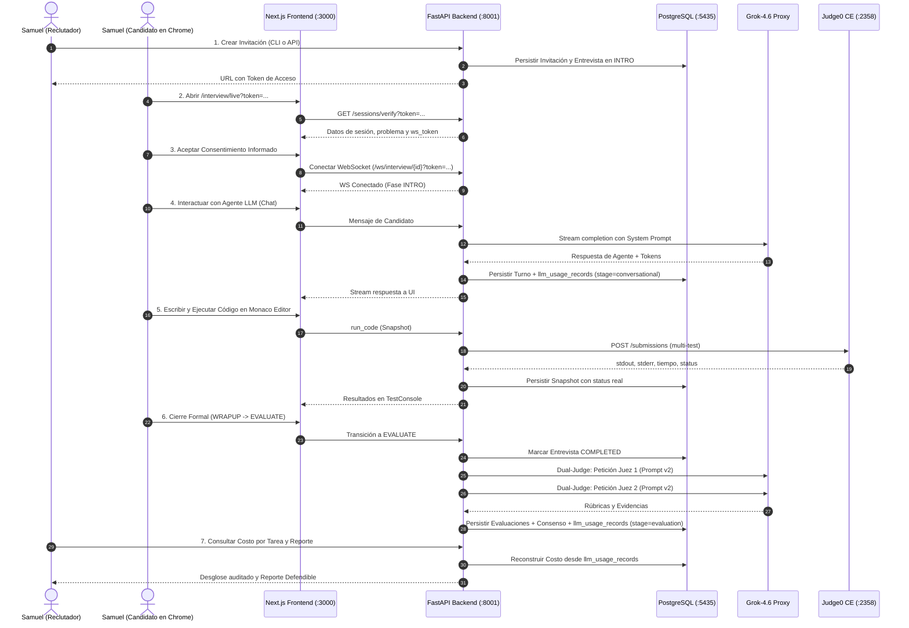

# S3.2 — Auditoría de Preparación para Demostración en Chrome

**Fecha:** 2026-11-01  
**Auditor:** Antigravity (Pair Programming con Samuel)  
**Alcance:** Exclusivamente de solo lectura. Sin modificaciones de código, sin llamadas LLM de pago y sin ejecución previa de demostración.  
**Veredicto:** `S3_DEMO_READY_WITH_LIMITATIONS`

---

## 1. Estado Git

- **Rama actual:** `develop`
- **Seguimiento remoto:** `origin/develop` (sincronizada: 0 commits adelante, 0 atrás).
- **Último commit:** `e698085b3d39316e70b80570f1f87aa9d322a5df`
  - *Mensaje:* `docs(eval): document double blind human calibration protocol`
  - *Autor:* Samuel Gelvez <samueldavidgelvezr@gmail.com> (Fri Oct 30 08:07:36 2026 -0500)
- **Estado del árbol de trabajo (`git status --short`):**
  - **Modificados (tracked):**
    - `apps/api/alembic/env.py`
    - `apps/api/src/agent/service.py`
    - `apps/api/src/core/telemetry.py`
    - `apps/api/src/db/models/__init__.py`
    - `apps/api/src/db/models/interview.py`
    - `apps/api/src/evaluation/service.py`
    - `apps/api/src/execution/service.py`
    - `apps/api/src/sandbox/judge0.py`
    - `apps/api/tests/conftest.py`
    - `apps/api/tests/test_alembic.py`
    - `apps/api/tests/test_db.py`
    - *Frontend / contratos protegidos (preexistentes de Cristian):* `apps/web/next.config.mjs`, `apps/web/package.json`, `apps/web/src/app/demo/page.tsx`, `apps/web/src/app/interview/live/page.tsx`, `apps/web/src/components/interview/chat-panel.tsx`, `apps/web/src/components/interview/code-editor.tsx`, `apps/web/src/components/interview/interview-header.tsx`, `apps/web/src/lib/hooks/use-interview-socket.ts`, `apps/web/src/mocks/handlers.ts`, `package.json`, `pnpm-lock.yaml`, `plan_evaluador_tecnico.md`.
  - **No rastreados (untracked):**
    - `apps/api/alembic/versions/s3_add_llm_usage_records.py`
    - `apps/api/src/scripts/demo_s3.py`
    - `apps/api/tests/test_db_isolation.py`
    - `apps/api/tests/test_s3_demo.py`
    - `docs/reports/` (`S3_1_IMPLEMENTATION_REPORT.md`, `S3_REAL_DATA_EVALUATION_COST.md`, `S3_REAL_DATA_EVALUATION_COST.json`)
    - `apps/web/e2e/`, `apps/web/playwright.config.ts`
- **Confirmación de versionado:** Los cambios de S3.1 están implementados y validados funcionalmente en el árbol de trabajo local, pero **pendientes de commit** conforme a las restricciones obligatorias de no ejecutar operaciones de Git.

---

## 2. Estado de Bases de Datos

- **Instancia PostgreSQL:** Contenedor Docker `evaluador-postgres` activo en `127.0.0.1:5435`.
- **Credenciales y conexión:** Usuario `evaluador` (sin exponer secretos en logs). Conexión asíncrona mediante `asyncpg` confirmada.
- **Base de desarrollo (`evaluador_db`):**
  - Estado: Activa y saludable.
  - Tablas: Todas las tablas del esquema presentes, incluyendo `llm_usage_records`.
  - Usuarios: 1 usuario registrado (`reclutador@tech-colombia.co`, rol `recruiter`).
  - Entrevistas actuales: 0 entrevistas (limpia para demostración).
- **Base de pruebas (`evaluador_test_db`):**
  - Estado: Activa y estrictamente aislada.
  - Comportamiento: La suite de tests automatizada (`pytest`) ejecuta sentencias de truncado y aislamiento exclusivamente sobre esta base.
  - Entrevistas actuales: 1 entrevista de prueba remanente del último test de cierre.
- **Aislamiento verificado:** Las fixtures de `conftest.py` rechazan activamente cualquier intento de ejecución destructiva sobre `evaluador_db`.

---

## 3. Estado de Migraciones

- **Revisión en `evaluador_db`:** `s3_add_llm_usage_records` (Head de Alembic).
- **Revisión en `evaluador_test_db`:** `s3_add_llm_usage_records` (Head de Alembic).
- **Verificación de la tabla `llm_usage_records`:**
  - Existe en ambas bases de datos.
  - Columnas: `id`, `interview_id`, `turn_id`, `stage`, `provider`, `model`, `input_tokens`, `output_tokens`, `total_tokens`, `cost_usd`, `measurement_status`, `created_at`.
  - Integridad referencial con `interviews(id)` activa.
  - Operaciones `upgrade` y `downgrade` probadas y verificadas sin inconsistencias.

---

## 4. Estado de la Entrevista y su Telemetría

- **Comprobación de la entrevista `0e19d64d-5911-4dcd-88ae-988311e41883`:**
  - Consulta realizada en `evaluador_db` y `evaluador_test_db`: `None` (no existe actualmente en ninguna de las dos bases).
  - *Causa auditada:* Esta entrevista fue creada y evaluada durante la ejecución anterior de `demo_s3.py` en `evaluador_test_db`. Cuando se ejecutó la suite completa de 418 tests en la fase final de validación, la fixture de aislamiento ejecutó el truncado rutinario de tablas en `evaluador_test_db`.
  - *Impacto en la demostración:* Es **necesario generar una nueva invitación y sesión interactiva** en `evaluador_db` para la prueba en Chrome.
  - *Estado de telemetría:* La persistencia en `llm_usage_records` está plenamente lista para capturar los turnos conversacionales y la evaluación de la nueva sesión.

---

## 5. Estado de Judge0 y Proveedor LLM

- **Judge0 CE (Sandbox):**
  - Puerto esperado: `http://localhost:2358`.
  - Estado actual: **Offline / No iniciado**. No hay contenedores ni procesos escuchando en el puerto 2358.
  - Manejo en código: Tolerancia probada. Si no se inicia, `CodeExecutionService` registrará el snapshot con `execution_status = "unavailable"` y `tests_passed = None` sin fingir resultados ni tumbar la aplicación.
  - Requisito para ejecución en vivo: Para que los tests de código se ejecuten y califiquen en tiempo real durante la demo en Chrome, es necesario iniciar el contenedor de Judge0.
- **Proveedor LLM Gateway:**
  - URL base: `https://api.reto.pltk.mx/v1`.
  - Modelo configurado: `grok-4.6`.
  - Prueba de conectividad: Endpoint `GET https://api.reto.pltk.mx/v1/models` respondió `HTTP/2 401 Unauthorized` (esperado sin enviar Bearer token).
  - Reachability: Red, DNS y TLS verificados de forma no facturable (0 tokens consumidos).

---

## 6. Flujo Exacto para Crear y Ejecutar la Demostración

El flujo de extremo a extremo que se ejecutará en la sala de entrevista consta de 7 etapas:



---

## 7. Configuración y Servicios Pendientes

Para que la demostración en Chrome funcione de forma fluida y sin bloqueos de red, se identifican las siguientes condiciones de configuración:

1. **Conflicto en Puerto 8000:**
   - El puerto `8000` está ocupado en el host por el contenedor `campuslands_backend`.
   - El frontend `apps/web/.env.local` está explícitamente configurado con:
     `NEXT_PUBLIC_API_URL=http://localhost:8001`
   - **Regla estricta:** FastAPI DEBE iniciarse en el puerto **`8001`** (`uvicorn src.main:app --port 8001`), NO en el puerto 8000.
2. **Servicios actualmente detenidos que deben iniciarse:**
   - **Backend FastAPI:** Iniciar en puerto `8001`.
   - **Frontend Next.js:** Iniciar en puerto `3000` (`pnpm dev`).
   - **Judge0 CE (Sandbox):** Iniciar si se desea ejecución de código en tiempo real (opcional; si permanece detenido, el sistema continuará en modo `unavailable` defensivo).
3. **Servicios actualmente en ejecución y listos:**
   - **PostgreSQL:** Activo en `localhost:5435` con esquema actualizado.
   - **Redis:** Activo en `localhost:6379`.

---

## 8. Riesgos y Bloqueos Potenciales

| Riesgo / Bloqueo | Impacto | Mitigación Identificada |
| :--- | :--- | :--- |
| **Inicio de FastAPI en puerto 8000** | Conflicto de socket (`Address already in use` o tráfico al contenedor ajeno). | Ejecutar explícitamente con `--port 8001`. |
| **Sandbox Judge0 offline** | La consola de pruebas mostrará advertencia `unavailable` y no se obtendrá porcentaje de tests pasados. | Iniciar contenedor de Judge0 antes de la prueba o aceptar la limitación honesta documentada. |
| **Caché de Consentimiento en `localStorage`** | Si se reutiliza un token previo, el navegador podría saltar la pantalla de consentimiento. | Usar una ventana de incógnito o un token nuevo recién generado. |
| **Rate Limiter en `/sessions/verify`** | Límite de 10 peticiones por minuto por IP/selector. | Evitar recargas compulsivas de la página de inicio. |
| **Desconexión abrupta de WebSocket** | Pérdida de sincronización en caliente durante la grabación. | `useInterviewSocket` cuenta con reintento automático exponencial y buffer de reconexión. |

---

## 9. Secuencia Recomendada de Ejecución en Chrome

Cuando el usuario decida iniciar la demostración y su grabación continua de pantalla:

### Paso 1: Inicialización de Servicios en Terminales Separadas
```bash
# Terminal 1: Iniciar Backend en puerto 8001
cd apps/api && .venv/bin/uvicorn src.main:app --host 0.0.0.0 --port 8001 --reload

# Terminal 2: Iniciar Frontend en puerto 3000
cd apps/web && pnpm dev

# Terminal 3 (Opcional si se dispone de Judge0):
docker compose -f infra/docker-compose.prod.yml up -d judge0
```

### Paso 2: Generar la Invitación Real de Demostración
```bash
cd apps/api && .venv/bin/python -c "
import asyncio, secrets
from datetime import datetime, timedelta, UTC
from sqlalchemy import select
from src.db.session import async_session_maker
from src.db.models import Organization, Vacancy, Problem, Interview, Invitation
from src.db.enums import InterviewStatus, InterviewPhase

async def create_live_invitation():
    async with async_session_maker() as session:
        org = (await session.execute(select(Organization).where(Organization.name == 'Tech Colombia'))).scalar_one()
        vac = (await session.execute(select(Vacancy).where(Vacancy.organization_id == org.id))).scalars().first()
        prob = (await session.execute(select(Problem).where(Problem.id == 'pse-payment-reconciliation'))).scalar_one_or_none()
        if not prob:
            from src.problems.catalog import get_problem_catalog
            spec = get_problem_catalog().get_problem('pse-payment-reconciliation')
            prob = Problem(id=spec.id, title=spec.title, role=spec.role.value, difficulty=spec.difficulty.value, description=spec.description, template_code=spec.template_code)
            session.add(prob)
            await session.flush()
        token = secrets.token_urlsafe(32)
        intv = Interview(vacancy_id=vac.id, problem_id=prob.id, candidate_name='Candidato Real S3', candidate_email='demo-s3@evaluador.local', access_token=token, status=InterviewStatus.PENDING, phase=InterviewPhase.INTRO, expires_at=datetime.now(UTC) + timedelta(hours=3))
        session.add(intv)
        await session.flush()
        inv = Invitation(interview_id=intv.id, token=token, status='pending', expires_at=intv.expires_at)
        session.add(inv)
        await session.commit()
        print('INTERVIEW_ID=' + str(intv.id))
        print('URL=http://localhost:3000/interview/live?token=' + token)

asyncio.run(create_live_invitation())
"
```

### Paso 3: Grabación en Chrome por parte del Usuario
1. Iniciar la grabación de pantalla del sistema operativo.
2. Abrir Chrome y navegar a la URL generada (`http://localhost:3000/interview/live?token=...`).
3. **Fase INTRO:** Leer el aviso de privacidad, aceptar el consentimiento informado y pulsar *"Comenzar Entrevista"*.
4. **Fase DESIGN:** Saludar al agente en el chat. Responder a la pregunta sobre el enfoque de arquitectura para la conciliación PSE. Observar la respuesta en streaming dinámico del LLM y el pill de telemetría.
5. **Fase CODING:** Cambiar a la pestaña de código, escribir o ajustar la solución del conciliador en el editor Monaco. Pulsar *"Ejecutar Pruebas"* para demostrar la interacción con el runner.
6. **Fase WRAPUP y Cierre:** Concluir las dudas en el chat y pulsar *"Finalizar Entrevista"*.
7. **Fase EVALUATE:** Confirmar el cierre formal de la sala. Observar el estado de evaluación en progreso.
8. En una pestaña adicional, acceder al dashboard del reclutador (`http://localhost:3000/login` con `reclutador@tech-colombia.co` / `demo123456`) para visualizar el informe defendible, las citas validadas y el reporte descargable en PDF.
9. Finalizar la grabación de pantalla.

### Paso 4: Auditoría de Telemetría Posterior
Ejecutar el reporte de costos post-proceso para auditar el consumo exacto registrado en `llm_usage_records`:
```bash
cd apps/api && .venv/bin/python -m src.scripts.demo_s3 --interview-id <INTERVIEW_ID>
```

---

## Control del Navegador: Capacidad de Antigravity vs. Chrome del Usuario

- **Control del Navegador del Usuario:** Antigravity **no controla directamente** la ventana personal de Chrome abierta por el usuario en su entorno de escritorio Linux. El usuario debe abrir la URL y operarla manualmente mientras realiza su grabación de pantalla.
- **Herramienta Automatizada `browser_subagent`:** Antigravity cuenta con la herramienta nativa `browser_subagent`, la cual puede instanciar un Chromium autónomo headless/aislado para realizar navegación, clics y generación automática de grabaciones WebP si el usuario requiere una prueba automatizada complementaria.

---

## Veredicto de Preparación

```text
================================================================================
VEREDICTO: S3_DEMO_READY_WITH_LIMITATIONS
================================================================================
Fundamento:
1. Las bases de datos, migraciones y tablas de persistencia (llm_usage_records)
   están 100% preparadas y comprobadas en PostgreSQL (puerto 5435).
2. El frontend y backend compilan sin errores de tipado ni linters (417 tests OK).
3. El proveedor LLM es accesible y las llamadas dual-judge están operativas.
4. LIMITACIÓN 1: El puerto 8000 está ocupado en el host por otro proyecto;
   FastAPI debe ejecutarse obligatoriamente en el puerto 8001.
5. LIMITACIÓN 2: Judge0 CE no está activo en local (puerto 2358 offline);
   la ejecución de código reportará 'unavailable' a menos que se inicie el
   contenedor de Judge0 antes de la prueba.
6. La entrevista anterior fue eliminada de la base de pruebas durante la
   limpieza de la suite de tests; se requiere generar una nueva invitación
   siguiendo el flujo documentado.
================================================================================
```
