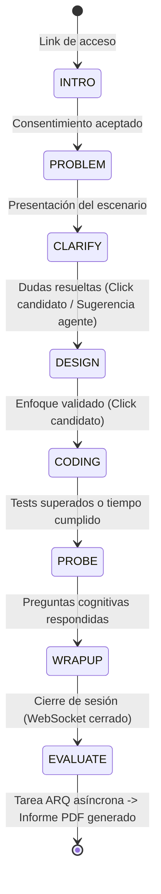

# 🎯 Evaluador Técnico de Candidatos: Plan de Proyecto y Tareas (v2.0 Definitiva)

> Agente de IA que realiza la entrevista técnica inicial, propone un problema real contextualizado, evalúa el **razonamiento y la trayectoria de depuración** (no solo la respuesta binaria) y entrega un **informe defendible y auditable**.
> **Clientes objetivo:** Empresas de tecnología, bootcamps y firmas de staffing en Colombia y Latinoamérica.

**Equipo y Responsabilidades:**
* **Samuel:** Backend, Arquitectura de Datos, Motor del Agente, Evaluación LLM y Sandboxing.
* **Cristian:** Frontend, Arquitectura de Experiencia de Usuario (UX/UI), Sala de Entrevista en Vivo y Telemetría.

**Herramientas de Desarrollo:**
* Samuel → `opencode` (+ Grok / LLM compatible con OpenAI)
* Cristian → `Antigravity`

---

## 1. Stack Tecnológico Definitivo

| Capa | Tecnología | Justificación y Responsable |
|---|---|---|
| **Backend / API** | **Python 3.12 + FastAPI** + Pydantic v2 | Ecosistema maduro de IA, validación estricta y tipado rápido. *(Samuel)* |
| **Motor del Agente** | **Máquina de estados híbrida** (Reglas deterministas + Sugerencias LLM) | Evita bucles infinitos; el usuario y el sistema controlan transiciones de fase críticas. *(Samuel)* |
| **LLM Gateway** | Cliente agnóstico compatible con OpenAI (`base_url` configurable) | Actualmente **Grok (xAI)**, configurable a OpenAI, Anthropic o Gemini sin cambiar código. *(Samuel)* |
| **Base de Datos** | **PostgreSQL 16** (SQLAlchemy 2 + Alembic) | Filtrado relacional indexado por tags/skills para el banco inicial. *(pgvector reservado para fase post-MVP)*. *(Samuel)* |
| **Cola / Tareas Asíncronas** | **Redis + ARQ** | Evaluación en segundo plano tras finalizar la entrevista y control de concurrencia. *(Samuel)* |
| **Ejecución de Código (Sandbox)** | `CodeRunnerInterface` + **Judge0 CE / Cloud Fallback** | Interfaz desacoplada para evitar bloqueos de Docker/cgroups v2 en local. *(Samuel)* |
| **Generación de Informes** | **Jinja2 + WeasyPrint** | PDFs profesionales estilizables con CSS estándar e imprimibles. *(Samuel)* |
| **Frontend** | **TypeScript + Next.js 15 (App Router)** | Rendimiento, SSR/SSG y arquitectura moderna de componentes. *(Cristian)* |
| **UI & Animaciones** | **Tailwind CSS + shadcn/ui + Framer Motion** | Estética moderna tipo Vercel/Linear con modo oscuro/claro nativo. *(Cristian)* |
| **Editor de Código** | **Monaco Editor** (`@monaco-editor/react`) | El editor de VS Code en la web, con debounce de snapshots para capturar trayectoria. *(Cristian)* |
| **Visualización de Datos** | **Recharts** | Gráficos de radar de competencias y líneas de tiempo de eventos. *(Cristian)* |
| **Comunicación en Vivo** | **WebSocket Bidireccional Único** | Comunicación unificada para chat, streaming de tokens, snapshots de código, tests y señales de integridad (sin mezclar SSE). *(Ambos)* |
| **Contrato de API** | **OpenAPI (FastAPI) ➡️ `openapi-typescript` + MSW** | Tipado estricto e independización de frontend mediante mocking inmediato. *(Ambos)* |
| **Orquestación del Monorepo** | **`just` (`justfile`) o `make`** | Comandos estandarizados para levantar, testear y sincronizar tipos con una sola línea. *(Ambos)* |
| **Infraestructura** | Docker Compose · GitHub Actions · Vercel (Front) · VPS / Fly.io (Back) | Despliegues continuos desacoplados. *(Ambos)* |

---

## 2. Decisiones de Arquitectura y Producto (ADRs Clave)

### ADR-0001: Comunicación Unificada vía WebSocket vs Dualidad con SSE
* **Decisión:** Usar una única conexión WebSocket persistente para la sala de entrevista en vez de combinar WebSocket con SSE.
* **Motivo:** Evita dolores de cabeza de desincronización, reconexiones dobles y saturación de puertos HTTP. Por el canal WebSocket fluyen mensajes tipados:
  * `{ "type": "agent_token", "delta": "..." }` (streaming de respuesta)
  * `{ "type": "code_snapshot", "code": "...", "timestamp": ... }` (trayectoria)
  * `{ "type": "phase_transition", "phase": "DESIGN" }` (cambio de estado)
  * `{ "type": "integrity_event", "event": "blur" }` (telemetría ética)

### ADR-0002: Por qué Entrevista por Chat Escrito + Código y NO Voz en el MVP
* **Decisión:** La entrevista técnica inicial es 100% interactiva vía texto técnico y editor de código en tiempo real.
* **Motivo:**
  1. **Cero sesgo de acento, dialecto o tono de voz** (imprescindible para el informe defendible).
  2. **Cero errores de transcripción (STT):** Los nombres de variables, sintaxis y bibliotecas no sufren alucinaciones acústicas.
  3. **Menor latencia y 80% menor costo operativo.**
  4. La mayoría de los desarrolladores expresan diseño de sistemas y código con mayor precisión reflexionando y escribiendo que bajo la presión de una llamada de voz.

### ADR-0003: Selección de Problemas Determinista vs `pgvector` Temprano
* **Decisión:** Para el banco inicial de 12 a 30 problemas, se utiliza filtrado relacional estándar indexado en PostgreSQL (`role`, `seniority`, `tags`, `difficulty`).
* **Motivo:** `pgvector` agrega complejidad innecesaria de infraestructura y no aporta valor medible cuando el catálogo es manejable. Se reservará para cuando el catálogo supere los 100 problemas.

### ADR-0004: Anti-Cheat Cognitivo y Defensa de Prompt Injection en el Juez
* **Decisión:**
  * **Anti-Cheat:** En la fase `PROBE`, el agente genera preguntas dinámicas obligatorias sobre las decisiones del código que el candidato acaba de escribir (p. ej., *"¿Por qué usaste esta estructura y cómo impacta la memoria en el peor de los casos?"*). Si el candidato copió de ChatGPT sin entenderlo, su incoherencia quedará expuesta.
  * **Defensa de Inyección:** En la fase `EVALUATE`, las entradas del candidato se encapsulan en etiquetas XML estrictas (`<untrusted_candidate_input>`) con instrucciones explícitas al modelo juez de ignorar cualquier directiva de sistema dentro de esas entradas.

---

## 3. Estructura del Monorepo

```
evaluador-tecnico/
├── justfile                  # Comandos globales: just dev, just test, just update-contracts
├── apps/
│   ├── api/                  # FastAPI (Samuel)
│   │   ├── src/
│   │   │   ├── core/         # Configuración, seguridad JWT, logging estructurado
│   │   │   ├── db/           # Modelos SQLAlchemy, migraciones Alembic
│   │   │   ├── llm/          # Gateway agnóstico, prompts versionados
│   │   │   ├── agent/        # Máquina de estados y manejador de WebSocket
│   │   │   ├── evaluation/   # Juez LLM, prompts delimitados, consistencia
│   │   │   ├── sandbox/      # CodeRunnerInterface (Judge0 / Local runner)
│   │   │   ├── problems/     # Cargador y validador de problemas YAML
│   │   │   ├── reports/      # Generador de PDF con WeasyPrint
│   │   │   └── api/          # Routers y endpoints HTTP
│   │   └── tests/
│   └── web/                  # Next.js 15 (Cristian)
│       ├── src/app/          # Páginas (landing, vacantes, sala entrevista, reporte)
│       ├── src/components/   # Design system (shadcn/ui), Monaco, gráficos Recharts
│       ├── src/lib/api/      # Cliente OpenAPI tipado y mocks con MSW
│       ├── src/lib/hooks/    # useInterviewSocket, useDebouncedSnapshot
│       └── tests/            # Vitest + Playwright
├── packages/
│   └── contracts/            # openapi.json versionado y types.generated.ts
├── problems/                 # Banco de problemas en YAML (revisable por PR)
├── evals/                    # Transcripciones doradas y calibración de jueces
├── infra/                    # Docker Compose base, nginx, scripts de despliegue
├── docs/                     # ADRs, arquitectura, guía de privacidad (Ley 1581)
├── AGENTS.md                 # Reglas compartidas para opencode y Antigravity
├── TASKS.md                  # Seguimiento diario
└── README.md
```

---

## 4. Máquina de Estados de la Entrevista



### Reglas de Transición:
* **Híbridas:** El agente puede decir: *"Has hecho buenas preguntas, ¿quieres pasar a proponer tu diseño?"*, pero el frontend tiene botones explícitos (`"Listo para diseñar"`, `"Empezar a codificar"`, `"Finalizar prueba"`). Esto elimina la incertidumbre de si el agente "entendió" que el candidato quería avanzar.
* **Captura de Razonamiento:** En `CODING`, el editor Monaco envía un snapshot con debounce de 3-5 segundos tras cada ráfaga de escritura o al presionar "Ejecutar pruebas", registrando la línea de tiempo de cambios.

---

## 5. Plan de Sprints Equilibrado (1 semana por Sprint)

### 🏁 Sprint 0: Cimientos y Setup Técnico (Juntos)

#### Samuel (Backend)
- [x] **S-00A** · Inicializar repo, `justfile` base y Docker Compose con PostgreSQL 16 y Redis.
- [x] **S-00B** · Definir contrato OpenAPI v0 preliminar con endpoints clave y documentar `ADR-0001` a `ADR-0003`.
- [x] **S-00C** · Configurar reglas de calidad backend: `ruff`, `mypy`, `pre-commit`.

#### Cristian (Frontend)
- [x] **C-00A** · Inicializar proyecto Next.js 15, Tailwind CSS, `shadcn/ui`, ESLint, Prettier y Husky.
- [x] **C-00B** · Configurar `packages/contracts` con script de generación de tipos TypeScript (`just update-contracts`).
- [x] **C-00C** · Definir sistema de diseño: paleta de colores, tipografía, modo oscuro/claro y componentes atómicos (Button, Input, Card, Badge).

**Entregable:** `v0.0.1`: Ambos pueden levantar su entorno local con `just dev` y el CI corre en verde.

---

### 🟦 Sprint 1: Base de Negocio y Parser de Vacantes

#### Samuel (Python)
- [x] **S-01** · Esqueleto FastAPI: configuración con `pydantic-settings`, logging estructurado y healthcheck.
- [x] **S-02** · Modelos SQLAlchemy + migraciones Alembic de entidades principales (`Vacancy`, `Problem`, `Interview`, `Turn`, `Snapshot`).
- [x] **S-03** · Autenticación JWT con roles (`admin`, `reclutador`) y soporte multi-tenant por `Organization`.
- [x] **S-04** · **LLM Gateway agnóstico**: cliente compatible con OpenAI (`base_url` para Grok), control de timeouts, reintentos y cálculo de tokens.
- [x] **S-05** · **Parser de vacantes**: recibe descripción en texto plano y extrae rol, seniority, stack y requerimientos en JSON estructurado (Pydantic).

#### Cristian (TypeScript)
- [x] **C-01** · Configurar **MSW (Mock Service Worker)** para simular todos los endpoints de FastAPI en el navegador.
- [x] **C-02** · Pantalla de autenticación y layout principal del panel del reclutador.
- [x] **C-03** · Pantalla **"Crear Vacante"**: área de texto con pegado rápido ➡️ vista previa del perfil analizado (chips interactivos de skills, selector de seniority).
- [x] **C-04** · Landing page pública del producto: propuesta de valor enfocada en empresas colombianas y bootcamps.

**Entregable:** `v0.1.0`: Flujo completo de login, creación de vacante y extracción de perfil conectado a mock y backend real.

---

### 🟨 Sprint 2: Banco de Problemas, Sandbox y Sala de Entrevista en Vivo

#### Samuel (Python)
- [x] **S-06** · **Banco de problemas en YAML** (`problems/`): mínimo 12 escenarios prácticos (ej. conciliación PSE, cálculo de nómina colombiana, logs de microservicios).
- [x] **S-07** · Selector de problemas: filtrado relacional por skills, seniority y lenguaje (rápido y determinista).
- [x] **S-08** · **`CodeRunnerInterface`**: adaptador de ejecución con timeout de CPU/memoria (driver Judge0 con fallback a runner local/cloud).
- [x] **S-09** · **Servidor WebSocket de la entrevista**: máquina de estados (`INTRO` ➡️ `PROBLEM` ➡️ `CLARIFY` ➡️ `DESIGN` ➡️ `CODING` ➡️ `PROBE`), streaming de texto y persistencia de turnos.
- [x] **S-10** · Prompts del entrevistador calibrados: tono profesional y pedagógico, pistas progresivas si el candidato se bloquea.

#### Cristian (TypeScript)
- [x] **C-05** · **Sala de entrevista (pantalla estrella)**:
  - Panel izquierdo: Descripción del problema y chat en vivo con streaming fluido.
  - Panel derecho: **Monaco Editor** con selector de lenguaje (Python/JS/SQL) y consola de resultados de tests.
- [x] **C-06** · Hook `useDebouncedSnapshot`: captura y envío automático de código al servidor cada 3-5 segundos de inactividad de tipeo.
- [x] **C-07** · Controles de fase en la UI (stepper animado y botón para solicitar paso a diseño o codificación).
- [x] **C-08** · Manejo de resiliencia de conexión WebSocket (banner de reconexión y restauración automática de estado).

**Entregable:** `v0.2.0`: Un candidato de prueba ingresa por enlace único, interactúa con el agente, escribe código en Monaco y ejecuta tests reales.

---

### 🟧 Sprint 3: Motor de Evaluación de Razonamiento

#### Samuel (Python)
- [ ] **S-11** · **Juez LLM con Rúbrica**: evaluación por dimensiones (1 a 5) citando evidencia obligatoria (IDs de turnos de chat, snapshots de código y ejecuciones de tests).
- [ ] **S-12** · **Análisis de trayectoria de depuración**: evaluar cómo reaccionó el candidato a tests fallidos y si mejoró la complejidad temporal/espacial.
- [ ] **S-13** · **Doble pasada de juez con chequeo de consistencia**: si dos jueces independientes difieren en >1 punto, marcar flag `needs_human_review`.
- [ ] **S-14** · Pipeline asíncrono con **Redis + ARQ**: evaluación disparada al finalizar la sesión con notificación de estado.
- [ ] **S-15** · Registro de auditabilidad: modelo LLM usado, versión de prompt, tokens consumidos y costo estimado.

#### Cristian (TypeScript)
- [x] **C-09** · **Vista de resultados del candidato**:
  - Resumen ejecutivo y semáforo de recomendación.
  - **Gráfico de radar interactivo** con Recharts por competencia técnica y blanda.
- [x] **C-10** · **Panel de evidencia interactivo**: al hacer clic en cualquier puntaje de la rúbrica, resalta el fragmento de chat o el código exacto que sustenta la nota.
- [ ] **C-11** · **Reproductor de la entrevista (Timeline Player)**: barra deslizadora para ver cómo evolucionó el código paso a paso a lo largo del tiempo.
- [ ] **C-12** · Tabla comparativa de candidatos por vacante con filtros por score y estado.

**Entregable:** `v0.3.0`: Entrevista concluida ➡️ evaluación asíncrona ➡️ panel de resultados con evidencia auditable y reproductor de código.

---

### 🟥 Sprint 4: Anti-Cheat Cognitivo, Informe Defendible y Privacidad

#### Samuel (Python)
- [ ] **S-16** · **Anti-Cheat Cognitivo en fase `PROBE`**: generación de preguntas dinámicas sobre el código escrito por el candidato (justificación de algoritmos y casos borde).
- [ ] **S-17** · **Defensa de Prompt Injection en evaluación**: envoltura de entradas no confiables en bloques `<untrusted_candidate_input>` con sanitización estricta.
- [ ] **S-18** · **Generador de informe PDF con WeasyPrint**: maquetación elegante, radar vectorial, evidencias tabuladas, código final y marca de agua auditable con hash único.
- [ ] **S-19** · **Anonimización estricta**: el módulo evaluador no recibe nombre, género, edad ni datos identificables del candidato (ciego a sesgos).
- [ ] **S-20** · Cumplimiento de la **Ley 1581 de 2012 (Colombia)**: endpoints para revocatoria de consentimiento y borrado seguro de datos.

#### Cristian (TypeScript)
- [ ] **C-13** · Captura ética de señales de integridad: detección de eventos de pegado masivo de código (`paste`) y pérdida de foco de ventana (`blur/focus`).
- [ ] **C-14** · Pantalla de consentimiento previo informando con total transparencia los datos recopilados y derechos legales del candidato.
- [ ] **C-15** · **Vista web del informe defendible**: maquetada para lectura rápida del Tech Lead y botón de descarga del PDF generado.
- [ ] **C-16** · Guía de preguntas recomendadas para la entrevista técnica humana final dentro del reporte.

**Entregable:** `v0.4.0`: Informe PDF listo para producción, defensas contra trampas e inyecciones, y cumplimiento normativo colombiano.

---

### 🟩 Sprint 5: Calibración, Pruebas y Endurecimiento

#### Samuel (Python)
- [ ] **S-21** · **Harness de calibración (`evals/`)**: conjunto de 20 transcripciones doradas calificadas por ingenieros humanos y cálculo de correlación de Spearman / Kappa de Cohen.
- [ ] **S-22** · **Pruebas de equidad (Fairness Tests)**: verificar que variaciones léxicas o demográficas no alteren los puntajes del juez.
- [ ] **S-23** · Endurecimiento del sandbox: desactivación de red, límites estrictos de memoria (128MB) y CPU (2s), pruebas contra fork bombs.
- [ ] **S-24** · Cobertura de pruebas unitarias y de integración ≥ 80% en los módulos `agent/` y `evaluation/`.

#### Cristian (TypeScript)
- [ ] **C-17** · Pruebas E2E completas con **Playwright**: flujo de creación de vacante ➡️ sesión de candidato ➡️ generación de reporte.
- [ ] **C-18** · Accesibilidad (WCAG AA): navegación por teclado, soporte para lectores de pantalla y contraste adecuado.
- [ ] **C-19** · Optimización de rendimiento: lazy loading del Monaco Editor y métricas Core Web Vitals (LCP < 2.5s, INP < 200ms).
- [ ] **C-20** · Pulido de micro-interacciones: transiciones con Framer Motion, estados vacíos (`empty states`) y notificaciones tipo toast.

**Entregable:** `v0.5.0`: Agente validado estadísticamente contra criterio humano, seguro y frontend de alta performance.

---

### 🚀 Sprint 6: Despliegue, Modo Demo y Pitch Comercial

#### Samuel (Backend)
- [ ] **S-25** · Pipeline de despliegue con Docker en VPS/Fly.io con migraciones automáticas en el arranque.
- [ ] **S-26** · Observabilidad y métricas: registro estructurado de costo en tokens por entrevista y alertas de latencia.
- [ ] **S-27** · Documentación técnica de cómo agregar nuevos problemas en YAML y cómo alternar proveedores de LLM.

#### Cristian (Frontend)
- [ ] **C-21** · Despliegue del frontend en Vercel con previsualizaciones automáticas por Pull Request.
- [ ] **C-22** · **Modo Demo offline/interactivo**: datos precargados con un candidato simulado para demostraciones comerciales instantáneas sin costo de API.
- [ ] **C-23** · Video demo guiado de 2-3 minutos mostrando el flujo completo.

#### Tareas Compartidas (Samuel + Cristian)
- [ ] **P-01** · Ensayo general de la demo de punta a punta.
- [ ] **P-02** · Preparación del Pitch Deck:
  - Dolor del mercado tech en Colombia (cientos de CVs, filtros obsoletos, costos de horas de Tech Leads).
  - Solución diferencial: razonamiento visible + informe defendible + anti-cheat cognitivo.
  - Modelo de pricing: por entrevista completada (B2B SaaS) y licencias para bootcamps/staffing.
- [ ] **P-03** · Congelar versión `v1.0.0` y redactar `CHANGELOG.md`.

---

## 6. Convenciones de Trabajo y Definición de "Hecho" (DoD)

1. **Revisión Cruzada:** Samuel aprueba el código de Cristian; Cristian aprueba el de Samuel. Nadie hace merge de su propio PR.
2. **Contratos Protegidos:** Cualquier cambio en `openapi.json` o en `packages/contracts` debe ser acordado antes de subir el PR.
3. **Commits Semánticos:** Seguir estrictamente Conventional Commits (`feat(scope): ...`, `fix(scope): ...`).
4. **Definición de "Hecho":**
   * [ ] Código probado localmente con `just test`.
   * [ ] CI en verde (lint, tipos, tests).
   * [ ] Manejo de estados de carga, error y vacío en la UI.
   * [ ] Documentación o ADR actualizado si aplica.
